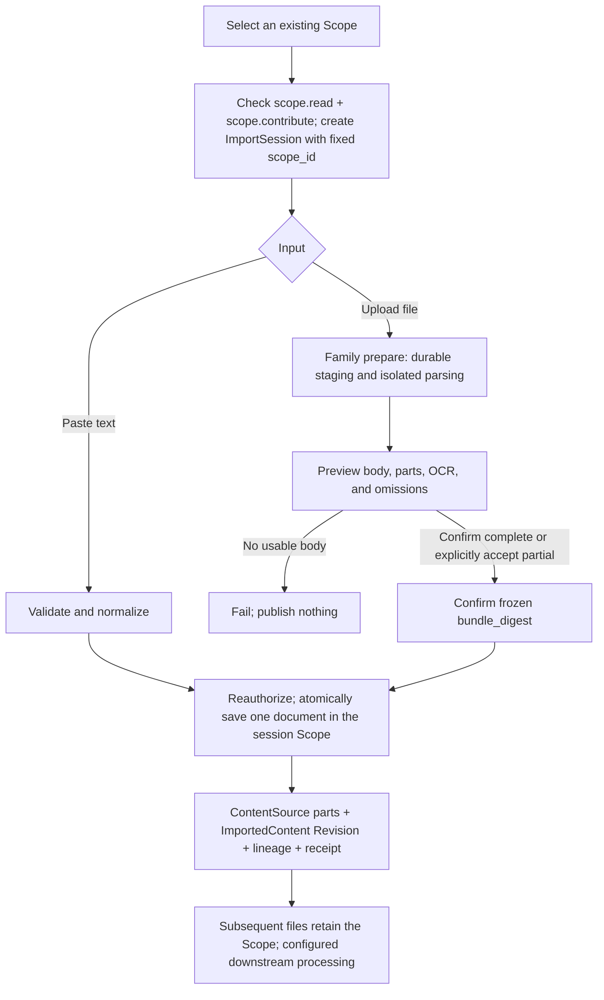
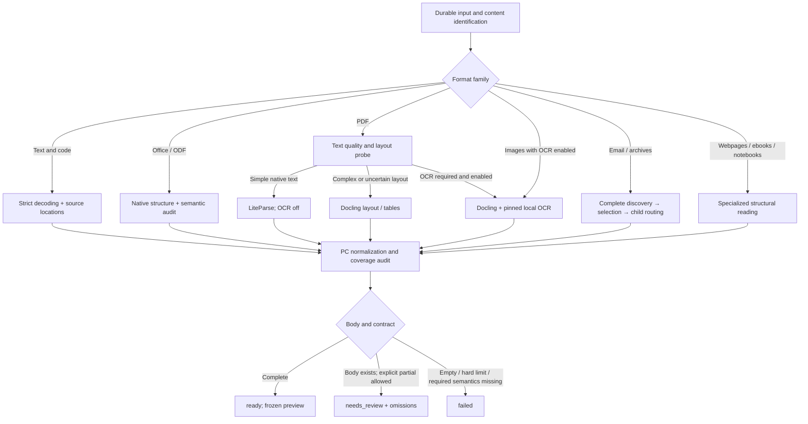
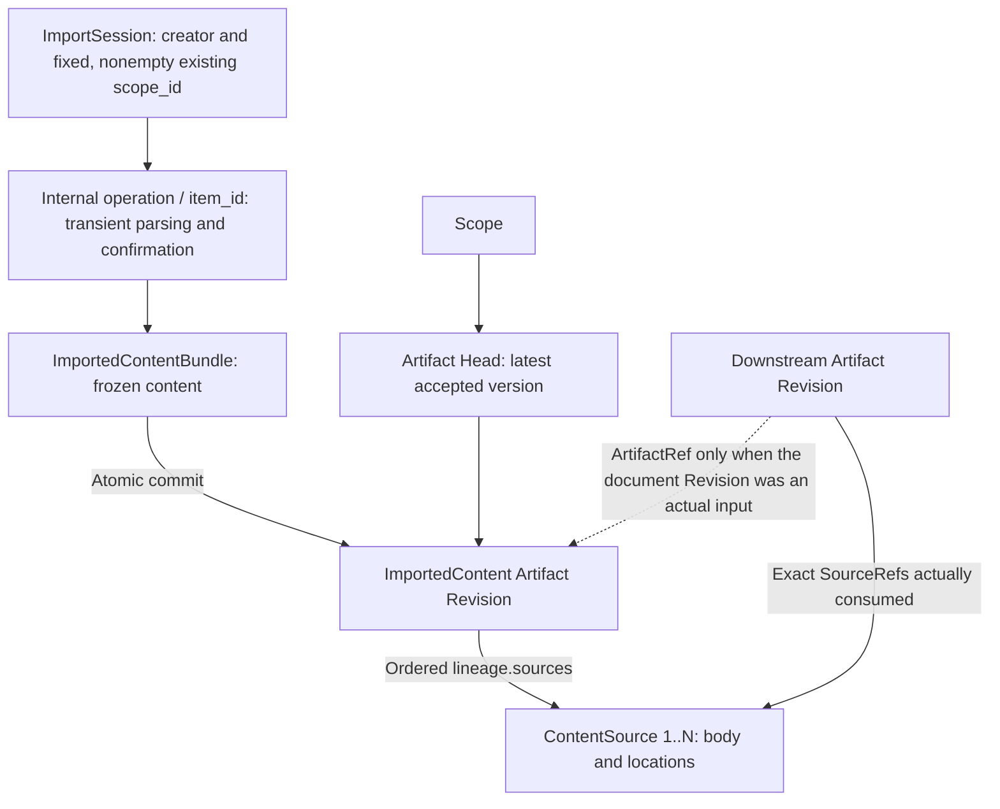
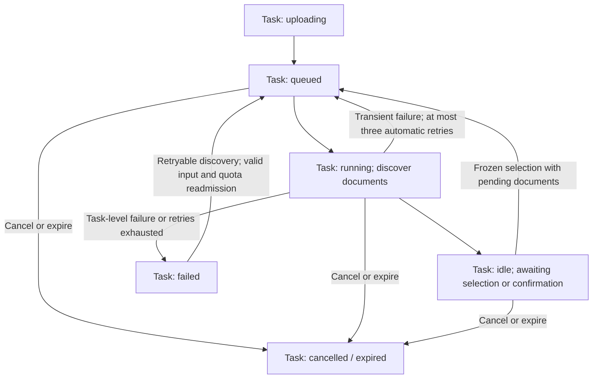
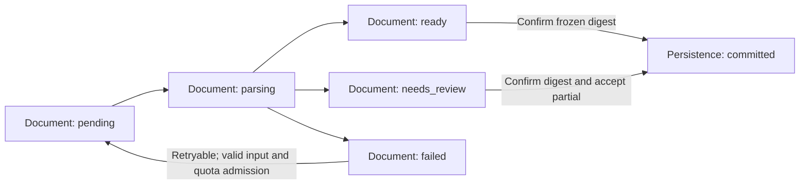

- Proposal Name: `text_material_import`
- Start Date: 2026-09-18
- Status: Proposed
- RFC PR: [oceanbase/powercontext#0000](https://github.com/oceanbase/powercontext/pull/0000)
- Design Baseline: [PowerContext master / cab054db (2026-10-19)](https://github.com/oceanbase/powercontext/tree/cab054dbf6d86e2311b079388e5158178257def2)
- Related RFCs: [Source Definition and Observation](1400_source_definition_and_observation_model.md), [Source and Artifact REST API](1437_source_artifact_rest_api.md), [Source access and generation eligibility](1458_artifact_generation_source_access.md), [Scope and Source discovery](1502_scope_source_discovery.md)

# Summary

Provide text material import for text, office documents, saved webpages, spreadsheets, email, ebooks, source code,
images, and archives. Users must select an existing Scope with `scope.read` and `scope.contribute` before pasting text,
uploading files, or using an independent OpenDAL worker to collect files from directories or object storage. Format
detection, decoding, parsing, optional OCR, and bounded segmentation produce immutable `content` Sources and an
`ImportedContent` Artifact (`family=importedcontent`), with an exact Revision receipt.

The product contract combines broad format coverage with explicit capability levels. Lightweight text can be saved
directly; complex files use isolated parser workers; scans and images require explicit OCR enablement. The standard
document package targets PDF, modern and legacy Office, OpenDocument, HTML, email, and ebooks. Deployments expose actual
formats, parsers, and limits. Detecting a format or extracting only metadata is not successful body import.

One logical document has one ImportedContent Artifact. `source_kind` is always `content`; each newly accepted snapshot
becomes an immutable Revision whose exact ContentSource references hold the body. Success means the imported Artifact
and its evidence were saved, not that downstream Memory generation, binary archival, or full-text indexing completed.
Head is the latest version accepted by PowerContext, not necessarily the current external file. Continuous collection
does not propagate deletion. This RFC proposes contracts; it does not claim released functionality.

Saved materials reuse Artifact tables, standard reads, Revisions, and lineage. ImportedContent-specific operations own
writes. Progress and private previews belong to a reclaimable internal operation ledger, not Artifact Revisions or a
separate FileImportJob business resource.

# Motivation

Project materials extend beyond TXT and Markdown to Word, PDF, Excel, PowerPoint, webpage exports, email, and scans. An
extension allowlist alone cannot decode binary formats, recognize scans, preserve table relationships, segment long
documents, or explain partial extraction and recovery.

Existing ContentSource, Scope authorization, Source journals, text projections, Source collection/exact reads, and the
OpenDAL evaluation Connector's durable receipts and checkpoint CAS provide persistence foundations, not general file
parsing.

The existing OpenDAL evaluation uses `text-file-snapshot` and registers a Definition manifest. Its UTF-8 collection
behavior, permissions, and public reads do not define this proposal's support contract. This design reuses the built-in
`content` Source and adds an import application service and optional parser deployments without changing existing Source
Create/Capture APIs.

Users need to know which formats their deployment can read, what was extracted or omitted, the destination Scope, and
how to recover from retries and failures.

# Guide-level explanation

## Supported formats and capability levels

The following matrix is the target. A is the base capability, B the standard document package, and C optional OCR or
extension adapters. Each published entry requires real fixtures. Missing dependencies mean unavailable; unfinished
adapters mean planned, not supported.

| Category | File types and common extensions | Level and extracted content |
| --- | --- | --- |
| Plain text and logs | `.txt`, `.text`, `.log`; explicitly selected extensionless text | A; body and line numbers |
| Markdown and lightweight markup | `.md`, `.markdown`, `.mdown`, `.rst`, `.adoc`, `.asciidoc`, `.org`, `.tex` | A; markup source, paragraphs, and lines; no typesetting execution |
| Data and configuration | `.csv`, `.tsv`, `.json`, `.jsonl`, `.ndjson`, `.yaml`, `.yml`, `.toml`, `.ini`, `.cfg`, `.conf`, `.xml` | A; original text and verifiable record/row/column locations; no object construction or external entities |
| Code and build files | `.py`, `.js`, `.ts`, `.jsx`, `.tsx`, `.java`, `.c`, `.h`, `.cpp`, `.hpp`, `.go`, `.rs`, `.sh`, `.bash`, `.zsh`, `.sql`, `.css`, `.scss`, `.vue`, `.svelte`, `.rb`, `.php`, `.swift`, `.kt`, `.kts`, `.scala`, `.r`, `.R`, `.lua`, `.pl`, `.ps1`, `.bat`, `.cmd`, `.proto`, `.graphql`, `.gql`, `.diff`, `.patch`; Dockerfile, Makefile, CMakeLists.txt | A; preserve text without running, compiling, or installing dependencies |
| Subtitles and records | `.srt`, `.vtt`, `.ass`, `.ssa`, `.ics`, `.vcf` | A; timestamps or original fields; no calendar/contact API calls |
| Saved webpages | `.html`, `.htm`, `.xhtml`, `.mhtml`, `.mht` | B; static DOM body, headings, lists, tables, and link text; no scripts, external fetches, or browser-computed visibility guarantee |
| PDF | `.pdf` | B; text layer, page numbers, extractable tables; scanned/mixed pages require C-level OCR |
| Word and templates | `.docx`, `.doc`, `.dot`, `.dotx`, `.docm`, `.dotm` | B; paragraphs, headings, tables, footnotes; macros never execute |
| Excel and templates | `.xlsx`, `.xls`, `.xlsb`, `.xlt`, `.xltx`, `.xlsm`, `.xltm` | B target; sheets, cell values, formulas, existing cached results, and ranges; full and values-only XLSB profiles have separate admission rules in Section 1.4 |
| PowerPoint and templates | `.pptx`, `.ppt`, `.pps`, `.pot`, `.ppsx`, `.potx`, `.pptm`, `.ppsm`, `.potm` | B; slide text, tables, speaker notes, and slide order |
| Open office formats and rich text | `.odt`, `.ott`, `.ods`, `.ots`, `.odp`, `.otp`, `.fodt`, `.fods`, `.fodp`, `.rtf` | B; document, sheet, or presentation content with corresponding location rules |
| Ebooks | `.epub`, `.fb2` | B; navigation, chapters, and body; no DRM decryption |
| Email and mailbox exports | `.eml`, `.msg`, `.mbox` | B; subject, sender information, body; one document per message, explicitly selected attachments |
| Notebooks | `.ipynb` | B; Markdown/code cells and saved text outputs; no execution or recalculation |
| XML documents and feeds | `.rss`, `.atom`, `.opml`, `.xlf`, `.xliff`, `.tmx`, `.svg` | A source preservation; B semantic text extraction; SVG text nodes only, no execution or graphical understanding |
| Images and scans | `.png`, `.jpg`, `.jpeg`, `.tif`, `.tiff`, `.bmp`, `.webp`; static `.gif` | C; OCR text, image/page order, and available locations; animated GIFs cannot silently use only the first frame |
| Batch archives | `.zip`, `.tar`, `.tar.gz`, `.tgz`, `.gz`, `.bz2`, `.xz` | B; safe expansion and per-member identification/import; an archive is not a body format |
| Extended archives | `.7z`, `.rar`, `.tar.bz2`, `.tbz2`, `.tar.xz`, `.txz` | C; installed and validated unpacking adapters required |
| Proprietary/long-tail formats | `.pages`, `.numbers`, `.key`, `.wps`, `.et`, `.dps`, `.wpd`, `.hwp`, `.chm`, `.one`, `.pst`, `.mobi`, `.azw`, `.azw3`, `.heic`, `.heif` | C extension targets; admission per format generation, actual body extraction, decoder, and license; a generic parser installation is insufficient |

A and B are the formal delivery scope; C uses the same extension mechanism with deployment-specific enablement. A
lightweight installation may enable only A. Standard installations must bundle and pin B dependencies. Reading
WPS-produced DOCX/XLSX/PPTX does not imply native WPS/ET/DPS support; detecting newer iWork containers does not prove
body extraction.

The explicit “read as plain text” fallback is not limited to listed suffixes, but must pass encoding, control-character,
and size checks. Directory collection scans allowed types, not every decodable file. Defaults exclude keys, credentials,
`.env`, version-control directories, dependencies, and build outputs; users can explicitly select other rules.

Audio/video transcription, arbitrary database dumps, executable decompilation, graphic/chart reasoning, and breaking
encryption/DRM are out of scope. Yuque, webpage, and Git URL acquisition belong to independent Connectors. Importing
local HTML or exported Markdown does not implement URL fetching.

## User flow

Users select an existing contributable Scope first. Global entry points require explicit selection; an entry inside a
Scope may preselect it but must display and authorize it. Without a valid destination, creating an ImportSession,
pasting, and uploading are disabled. When none is available, direct users to the existing Scope management flow. The
import UI neither offers Scope creation nor creates one automatically.

After selection, show actual formats, limits, and caller permissions. Creating an ImportSession fixes a nonempty
`scope_id` and its creator. All inputs in that session belong to that Scope. Changing destinations requires a new
session; parsing or unconfirmed inputs cannot migrate.

Validated plain text can be confirmed immediately. Files are uploaded and parsed first, then previewed with
page/sheet/slide counts, segment counts, actual OCR use, and omissions. Confirmation rechecks Scope and write
permission, and saves one document's Sources, ImportedContent Revision, Head, lineage, and receipt in one transaction.
Failure, cancellation, or preview alone publishes nothing.



Ordinary imports require `scope.read` and `scope.contribute`, not `server.admin`. A session is not an authorization
grant. Revocation, a missing destination, or an unwritable target prevents confirmation; it cannot silently choose
another target. Administrative operations follow Section 10.

A first manual upload or paste defaults to creating a new document and allocating `artifact_id`. Updating requires the
existing document's update action, explicit `artifact_id`, and expected Head Revision. Matching filenames, similar
bodies, or identical digests never merge identities automatically; duplicate suggestions require user choice. Renaming a
file does not alter an explicitly selected identity.

Show each file as awaiting upload, parsing, awaiting confirmation, saved, already present, needs attention, version
conflict, or outcome uncertain. Keep filename, selected Scope, and create/update intent visible. Concurrency still obeys
Scope-level quotas, idempotency, and Head checks.

For example, Word may save successfully while a scanned PDF without OCR needs attention and Excel contains formulas
without cached values. Identify affected PDF pages and offer a new OCR attempt or explicit partial acceptance. Display
Excel formulas and “no saved calculation result,” without invented values. Do not report all three as fully extracted.

Use “view extracted text” for parsed formats and “view original text” for plain text. Show supported handling and
omissions for images, layout, charts, and embedded objects. Neither parsing completion nor preview visibility means
Source or Artifact persistence has occurred.

## Format-specific behavior

- **Encoding:** UTF-8, BOM-marked UTF-16/UTF-32, and explicitly specified GB18030, GBK, Big5, Windows-1252, ISO-8859-1. Detection suggests an encoding; except for BOM and strictly valid UTF-8, guesses require confirmation. Never hide decode errors with replacement characters.
- **Sheets:** preserve sheet names and cell coordinates across all sheets. CSV/TSV retain source text and may add validated record/column locations. Never recalculate or refresh links. Hidden sheets/rows/columns are included and marked by default; explicit pre-preview exclusion enters snapshot identity.
- **Slides:** preserve slide order and separate notes. Include and mark hidden slides by default. Image text requires OCR and must not be counted as already read.
- **Word/open documents:** extract headings, body, tables, and footnotes under declared rules. Use the accepted-changes view. Comments are excluded by default with counts; optional inclusion records authors. A parser unable to produce these views reliably reports insufficient capability.
- **HTML/notebooks:** do not execute JavaScript/cells or fetch CSS, images, or links. Include saved notebook text outputs by default; hidden metadata, rich media, and widgets are not body text.
- **PDF/OCR:** choose native text or OCR per page/region without double counting. Distinguish blank, image-only, and failed pages. OCR is machine recognition, not an exact transcription guarantee. Unavailable layout/page counts are unknown, not proof of completeness.
- **Email/archives:** retain quoted history; select one plain-text or HTML alternative and record the rule. List attachments by default but import only selections. Expand the first archive layer by default; nesting requires explicit enablement and depth limits. Keep failed/unselected members in the manifest.

## Saving and downstream processing

One logical document has one ImportedContent Artifact; accepted snapshots are Revisions. Long bodies become multiple
immutable ContentSources. All parts, the Revision, Head, lineage, pending processing, and receipt commit together in the
session's existing Scope, without creating a Scope or initializing permissions. Different files, archive members, and
messages may succeed independently.

Success requires neither an LLM nor Candidate approval. Existing processor configuration and domain contracts determine
whether Memory and other processors consume these Sources, how much they consume, and their outputs. ImportedContent
registers no default generation processor or recursive generation behavior.

Historical Revisions and Sources remain immutable when Head changes. Details may show history and downstream references
based on actual exact SourceRefs or ArtifactRefs; import cannot prepopulate future related Artifacts. A consumer window
need not consume every part, so do not claim full-document understanding.

Original binaries are parser staging, not a permanent archive. Persist extracted text, digests, parser versions,
locations, and omissions; binary downloads and archival are outside this release.

## Continuous collection and Dashboard

An OpenDAL worker near the storage holds read credentials and submits bytes. The Server does not read arbitrary
user-supplied filesystem paths or URLs. Text and complex files use the same capability matrix; an external scheduler
owns periodic execution.

Dashboard retains Tabler, Jinja2, HTMX, both languages, and light/dark themes.
`POWERCONTEXT_SERVER_DASHBOARD_TEXT_IMPORT_ENABLED` explicitly enables its write entry point and defaults to false,
preserving static Bearer and enforced-access prerequisites. File parsing also requires its service; disabling it does
not block saved-material reads.

The page flow is existing Scope selection, material list, text/file selection, parsing preview and issues, confirmation,
then exact reading. Scope navigation cannot retarget running operations or submit pending inputs. Accepted parsing
operations resume after browser closure; incomplete uploads require reselecting the local file.

# Reference-level explanation

## 1. Architecture

The user-flow diagram separates input, parsing, and persistence. ImportedContent prepare creates a frozen
ImportedContentBundle through an internal ledger and isolated workers. Only user confirmation or a worker's explicit
acceptance policy invokes ContentImportApplication's per-document atomic commit. Existing Artifact processing retains
its configuration and progress semantics.

Acquisition, parsing, text persistence, and Artifact generation are four boundaries. Core does not import arbitrary
user-selected parsers, execute macros, or run code. Production provides independent parser workers; lightweight text
does not require document-parser dependencies.

### 1.1 Parser responsibilities and selected components

Prefer native structure, route PDF by layout, and enable OCR explicitly. PowerContext owns detection, structural
auditing, bundle normalization, evidence segmentation, operations, and persistence. Libraries decode formats and perform
layout/OCR; this proposal does not build a general OCR model. Profile names below are proposed product contracts, not
existing upstream APIs or completed adapters.

| Component | Selected responsibility | Excluded responsibility |
| --- | --- | --- |
| Native text/container adapters | Strict decoding; CSV/JSON/XML locations; OOXML/ODF audits; email/archive discovery | No execution or LLM rewriting |
| LiteParse | Simple PDF text, geometry, and complexity signals; built-in OCR off on the standard path | No universal Office-to-PDF conversion; cleaned Markdown cannot replace complete evidence |
| Docling | Complex PDF layout and modern Word/open-document structure; selected local OCR engine when enabled | No material identity, commits, indexing, or direct reuse of retrieval chunks as Sources |
| openpyxl / Apache POI | Native cells, formulas, stored values; POI also adapts legacy Office | No formula calculation, refreshed connections, or workbook printing to PDF |
| python-pptx + OOXML audit | Modern slide text, tables, notes, hidden state | No macros, animation interpretation, or chart reasoning |
| Apache Tika | Controlled legacy, RTF, MSG, and admitted long-tail parsing | No unrestricted autodetection, recursion, cloud OCR fallback, or metadata-only success |
| Local RapidOCR | Scanned PDFs/images through Docling; initial target languages Simplified Chinese and English | No automatic external transfer; Traditional Chinese, other languages, and handwriting require separate validation |
| MinerU / DeepDoc / LlamaParse | Independently enabled C-level alternatives; LlamaParse is external or enterprise self-hosted | No implicit fallback from standard profiles |
| LlamaIndex | Optional future Reader/retrieval-transform reference and indexing use | Does not own transactions, versions, or Sources; no default silent Reader error skipping |

Selections draw on the [RAGFlow study](https://yuque.antfin.com/obopensrc/knowledge_sharing/lmziuic5tzhgny8c),
[Docling/MinerU study](https://yuque.antfin.com/obopensrc/knowledge_sharing/rcga2z7gr8r3vwbo), and [LiteParse/LlamaIndex
study](https://yuque.antfin.com/obopensrc/knowledge_sharing/yl6nfo4yugep4n6a). These are implementation choices, not a
quality ranking. Initial adapter baselines are LiteParse Python 2.14.7 and Docling 2.129.0; MinerU 4.0.5 is an optional
validation baseline. Release images must pin transitive dependencies, models, and conversion tools, never `latest`. Pin
other components and image digests after fixture and security validation.

### 1.2 Level A: native text, markup, and locations

Each group covers all corresponding extensions in the matrix. A preserves decoded original text; structural parsing adds
verifiable locations without rewriting the body by default.

| Input | Default profile and implementation | Extraction, locations, and failures |
| --- | --- | --- |
| TXT/TEXT/LOG, explicit extensionless text | `text-native-v1`: strict Python codecs | Preserve newlines, indentation, characters, lines; uncertain encoding requires confirmation |
| Markdown/RST/AsciiDoc/Org/TeX | `markup-source-v1`: same decoder; optional markdown-it-py block identification | Preserve markup source; no TeX rendering, includes, plugins, or remote resources |
| All code/build/diff/patch files | `code-source-v1`: original text and line index | No compiler/formatter; failed language recognition does not discard text |
| CSV/TSV | `delimited-text-v1`: source plus Python csv reader | Freeze delimiter, quotes, encoding; logical records, fields, source ranges; multiline fields allowed; ambiguous delimiter requires confirmation |
| JSON/JSONL/NDJSON | `json-source-v1`: bounded syntax scanning and record parsing | Preserve source and duplicate-key order; record/field occurrence locations; never replace source with dict serialization |
| YAML/YML/TOML/INI/CFG/CONF | `config-source-v1`: source; optional PyYAML SafeLoader, tomllib, interpolation-disabled ConfigParser validation | Bound YAML aliases/depth, no arbitrary construction; ambiguous key locations fall back to source lines |
| XML | `xml-source-v1`: DTD/entities/network disabled | Source, node paths, namespaces, available lines; no XInclude/XSLT |
| SRT/VTT/ASS/SSA | `subtitle-source-v1`: text and bounded timestamp scan | Original fields and time ranges; no sorting or translation |
| ICS/VCF | `record-source-v1`: source, folded lines, record boundaries | Distinguish physical lines/logical records; no calendar/contact calls |
| RSS/Atom/OPML/XLF/XLIFF/TMX/SVG source mode | `xml-source-v1` | Source preservation; semantic extraction uses a separate B profile, never silent switching |

Failed auxiliary validation reports usable source text but unavailable structural locations. If the selected profile
requires complete structure, fail or require review rather than substituting source mode. A's source fidelity does not
depend on structural parsing, but encoding, control-character, and size checks remain mandatory.

### 1.3 PDF: native text, layout, and OCR routing

`pdf-standard-v1` is a pinned composite profile. LiteParse first performs bounded probing. Use its structured
`text_items` when the entire native text layer is usable and no complex-layout signal exists. Multiple columns, complex
tables, unusual order, or uncertainty route to Docling's standard layout/table path. Both disable OCR and generative
enhancement by default; fixture-validated routing thresholds are versioned profile configuration.

| PDF condition | Parsing | Completeness rule |
| --- | --- | --- |
| Simple native text, normal reading order | LiteParse JSON/structured output → ordered PC blocks | Physical page order, display labels, dimensions, available bbox; not Markdown that drops headers/footers by default |
| Multiple columns, complex tables, contents/footnote layout | Docling pipeline, DoclingDocument and provenance | Structure/reading order; table rows, columns, merges, original page locations; not rendered Markdown alone |
| Scanned/mixed/garbled text, `ocr_mode=off` | Usable native text only; identify OCR-required pages/regions | Body exists: needs_review; metadata-only/empty: ocr_required or no_extractable_text failure |
| Scanned/mixed, `ocr_mode=auto` | Docling + pinned local RapidOCR where needed | Region deduplication; actual engine, language, OCR execution and omissions; needs_ocr is not proof of execution |
| `ocr_mode=force` | Same engine, forced within declared range | Use configured OCR output without duplicate native text; preview policy and possible quality changes |
| Unreliable formulas, handwriting, complex charts | Keep usable text/locations and report objects | Never invent text; user may start another attempt with a C-level MinerU/DeepDoc/LlamaParse profile |

`needs_ocr` and layout complexity are separate signals. No OCR requirement does not imply simple layout. Count source
pages, requested ranges, returned pages, blank pages, and failures independently. Engine `max_pages` truncation is not
completeness; an unrequested partial range caused by a hard limit rejects the document.

Choose one body backend per PDF in this release; it may use native text or OCR internally by page. Do not splice
different engines page by page because tables, reading order, and coordinates may disagree. Probe results may be cached,
but are not an interchangeable cross-engine representation. If cross-page table merging is unreliable, retain separate
tables/page ranges and report the unresolved relationship.

Include extractable headers/footers by default and mark their block types. Profiles declare watermark, annotation, form,
and image-text inclusion. An unenabled category is not a known zero; detected but unprocessed content enters omissions.
Locations describe provenance, not a promise of permanent binary PDF preview.

### 1.4 Level B: Office and open office formats

Native structure takes precedence over print layout. Modern Office is not converted to PDF by default. Identify
templates and macro variants by MIME, container content types, and relationships; read the original container rather
than renaming suffixes to bypass library limitations.

| Input | Default profile/backend | Preservation and admission |
| --- | --- | --- |
| DOCX/DOTX/DOCM/DOTM | `word-ooxml-v1`: Docling DOCX + PC OOXML audit/supplement | Headings, body, tables, footnotes/endnotes, revision view, selected comments; no macros; unsupported variants need a controlled OOXML adapter or remain planned |
| DOC/DOT | `word-legacy-v1`: controlled Tika OfficeParser / POI HWPF plus audit | Flat text does not prove footnote/revision/comment completeness; unreliable selected views fail capability_insufficient, without silent PDF conversion |
| XLSX/XLTX/XLSM/XLTM | `sheet-ooxml-v1`: openpyxl + raw OOXML cells/relationships | Sheets, A1 coordinates, types, merged ranges, hidden state, formulas/cached values; count macros as excluded objects |
| XLS/XLT | `sheet-biff-v1`: POI HSSF | Available formula-token expression and stored cache; no FormulaEvaluator; validate/reject individual BIFF generations |
| XLSB | `sheet-xlsb-v1`: POI XSSFB events plus explicit structure adapter | Full formula-and-value contract must pass before available; values-only is a separate profile, below |
| PPTX/PPSX/POTX/PPTM/PPSM/POTM | `slides-ooxml-v1`: python-pptx + raw OOXML audit | Slide order, text boxes/group text, tables, notes, hidden slides; template handling belongs to adapter, not file mutation |
| PPT/PPS/POT | `slides-legacy-v1`: POI HSLF in Java worker | Native slides/notes; do not infer page boundaries from Tika's concatenated text; unknown OLE/graphics are omissions |
| ODT/OTT/FODT | `odf-text-v1`: Docling + safe PC ODF XML | Validate package/flat forms, headings, tables, comments, revision views; no fallback to all XML text |
| ODS/OTS/FODS | `odf-sheet-v1`: safe native PC ODF XML | Tables/rows/columns, repeats, merges/covered cells, hidden state, formulas/stored values; budget repeats before expansion |
| ODP/OTP/FODP | `odf-slides-v1`: safe native PC ODF XML | draw:page order, text boxes, tables, notes, display state; explicitly downgrade location capability if object identity is unstable |
| RTF | `rtf-native-v1`: structured Tika RTFParser + PC normalization | Body/paragraphs, available tables/footnotes; list embedded objects without execution; report unsupported control groups |

**Word supplemental reads are adapter work, not a claim that Docling/python-docx implements everything.** Audit OOXML
relationships for paragraphs, tables, footnotes/endnotes, comments, and revision nodes. The accepted view includes
insertions/moveTo and excludes deletions/moveFrom; unsupported property or complex revisions cannot be guessed. Reject
profiles unable to produce that view. Another view requires supported capabilities and a new attempt. Insert
supplemental text at original anchors without duplicating or reordering it at the end.

**Never recalculate workbooks.** Align XLSX formula and `data_only` views by identical input digest, sheet, and
coordinates; read `<f>` and `<v>` directly when needed to distinguish empty cells, cached empty strings, and missing
caches. Formula, cached value, type, and formatted display are separate fields. Preserve external references as strings
without fetching. Report affected ranges for broken shared/array formulas or dynamic structures.

**XLSB is a known admission risk.** POI's public XSSFB documentation limits formula-expression extraction; readable XLSB
does not imply formula fidelity. `sheet-xlsb-v1` remains planned until its full contract works. An explicitly selected
`sheet-xlsb-values-v1` may import cached values only when sheets/cells/hidden ranges are verifiable. It always requires
review, declares omitted formula expressions, and requires `accept_partial`. Unverifiable coverage or no body still
fails. This does not complete B-level XLSB delivery and cannot satisfy automated complete-only collection. See [POI XLSB
limitations](https://poi.apache.org/apidocs/5.0/org/apache/poi/xssf/extractor/XSSFBEventBasedExcelExtractor.html).

**LibreOffice is outside the standard workbook path.** Conversion can change cached formulas, fonts, pagination, and
object semantics. Do not convert XLS/XLSB/ODS to XLSX/PDF to bypass the no-recalculation contract. Document conversion,
if needed, requires a separately published extension profile validated for no external links, macros, or computational
side effects; initial sheet guarantees cannot depend on it.

### 1.5 Level B: webpages, ebooks, email, notebooks, and archives

| Input | Default profile/implementation | Body/member rules |
| --- | --- | --- |
| HTML/HTM/XHTML | `html-dom-v1`: html5lib + PC DOM traversal; safe XML for XHTML | Headings, paragraphs, lists, tables, link text; exclude script/style/template and explicitly hidden nodes; no CSS/JS execution or browser visibility guarantee |
| MHTML/MHT | `mhtml-native-v1`: Python MIME → selected root HTML → html-dom | Identify root using root-part data/content-location; ambiguous roots fail; embedded resources listed, never fetched by URL |
| EPUB | `epub-spine-v1`: safe ZIP → container/OPF → spine → html-dom | Reading order, chapters, navigation, text; not ZIP filename order; no scripts, remote resources, or DRM |
| FB2 | `fb2-native-v1`: safe XML → body/section/notes | Body, chapters, footnote references; binary images are not text |
| EML | `mail-rfc822-v1`: Python email BytesParser | Decode headers/MIME; prefer usable text/plain in multipart/alternative, otherwise html-dom; list CID images/attachments, no double body |
| MBOX | `mailbox-mbox-v1`: bounded iteration + mail-rfc822 | Discover before selection/parsing; retain ordinal, available Message-ID, container chain; duplicate Message-ID is not unique identity |
| MSG | `mail-msg-v1`: controlled Tika/POI HSMF | Subject/sender/body; HTML via html-dom, RTF via rtf-native; recursive concatenation cannot replace complete attachment discovery |
| IPYNB | `notebook-native-v1`: bounded JSON + nbformat | Original Markdown/code/raw cell order; saved text/plain, stdout/stderr, textual errors by default; explicit sanitized HTML inclusion; rich media/widgets excluded |
| RSS/Atom/OPML | `feed-xml-v1`: format-specific safe XML mapping | Feed/channel/entry/item/outline titles, body, link text and node paths; no linked-body fetch |
| XLF/XLIFF/TMX | `translation-xml-v1`: schema-specific source/target/segment | Unit ID, language, source and translation marked separately; no duplicated combined body; validate XLIFF generations separately |
| SVG semantic mode | `svg-text-v1`: safe XML text/tspan/title/desc | No rasterization/script execution, path-text/graphic understanding, or image-resource fetch |
| ZIP/TAR/TAR.GZ/TGZ | `archive-native-v1`: bounded Python zipfile/tarfile streaming | Complete discovery before selection and dispatch; no extractall to arbitrary paths; reject links/devices/duplicate paths |
| GZ/BZ2/XZ | `compressed-stream-v1`: standard-library decoders | Reidentify decompressed stream: TAR enters archive discovery, otherwise one child document; not every stream is a multi-file archive |

Python MIME/mailbox provide basic reading; PC still owns budgets, malformed structures, selection, and identity. A
returned object does not prove a complete manifest. See [email
parser](https://docs.python.org/3/library/email.parser.html) and
[mailbox](https://docs.python.org/3/library/mailbox.html).

Tika invokes only registered format parsers with automatic OCR, network, and uncontrolled embedded recursion disabled.
Controlled callbacks expose attachments/resources for discovery rather than silently adding them to body text. If
detected attachments cannot be fully enumerated, discovery fails rather than publishing a selectable “complete” list.
Unselected embedded objects in ordinary documents follow declared exclusions.

### 1.6 Level C: OCR, alternative engines, and long-tail formats

| Input/need | Selected extension | Enablement/limits |
| --- | --- | --- |
| PNG/JPEG/BMP/WebP/static GIF | `image-ocr-v1`: Pillow decode/orientation → Docling + local RapidOCR | Explicit OCR; original-to-rotated coordinate mapping; no chart reasoning |
| Multipage TIFF/TIF | `image-multipage-ocr-v1`: bounded all-page enumeration → same OCR | Per-page counts, pixels, OCR budget; failed pages reported; not first frame only |
| Animated GIF/multiframe variants | Reject by default | Separate profile requires frame semantics and repeated-text validation |
| HEIC/HEIF | `heif-ocr-v1`: pillow-heif/libheif → image OCR | Distinguish primary, thumbnail, auxiliary, sequence images; fixed selection; metadata alone is insufficient |
| Alternative complex PDF/scans | `pdf-mineru-v1` / `pdf-deepdoc-v1` | Direct MinerU structure protocol or isolated DeepDoc wrapper; pin tier/models; no indirect whole-RAGFlow integration |
| Optional parsing service | `document-llamaparse-v1` | Explicit deployment enablement/user choice and visible data destination; pinned API/version/tier; download then freeze results; never automatic external fallback |
| 7Z/RAR | `archive-libarchive-v1`: validated libarchive-c decoders | Safe enumeration and bounded reads; per-method/generation admission; encrypted inputs rejected |
| TAR.BZ2/TBZ2/TAR.XZ/TXZ | `archive-native-extra-v1`: standard decompressor + tarfile | Same archive budgets; C switch remains required despite available dependencies |
| Pages | `iwork-pages-v1`: Docling format-iwork | Validate body/structure per generation; otherwise planned; metadata-only newer Tika support is insufficient |
| Numbers/Keynote | `iwork-legacy-v1`: only Tika-readable, structurally validated older generations | New generations planned; sheet/slide contracts mandatory; otherwise request XLSX/PPTX export |
| Native WPS/ET/DPS | `wps-native-v1`: reserved controlled adapter, initially planned | Export DOCX/XLSX/PPTX; renaming, recognition, or PDF printing is not native support |
| WPD | `wordperfect-tika-v1`: Tika WordPerfectParser | Validated generations and scope only |
| HWP | `hwp-tika-v1`: Tika HwpV5Parser | HWP v5 validation does not cover all HWP/HWPX |
| CHM | `chm-tika-v1`: controlled ChmParser discovery → html-dom | No help-program execution; require verifiable chapter order |
| ONE | `onenote-tika-v1`: Tika OneNoteParser | Validate pages/sections/embedded objects; not full notebook synchronization |
| PST | `pst-tika-v1`: controlled OutlookPSTParser discovery → mail adapter | Require complete folders/messages/attachments and stable identity rules; no mailbox account linkage |
| MOBI/AZW/AZW3 | `ebook-calibre-v1`: isolated ebook-convert → EPUB → epub-spine | DRM-free validated variants only; pinned conversion/options and loss reporting; disabled by default |

References: [Tika formats](https://tika.apache.org/docs/4.0.x/formats.html), [Docling
formats](https://docling-project.github.io/docling/usage/supported_formats/),
[pillow-heif](https://pillow-heif.readthedocs.io/en/stable/pillow-plugin.html), and [calibre
conversion](https://manual.calibre-ebook.com/generated/en/ebook-convert.html). Profiles are PC implementation choices;
upstream support does not prove compliance with every required semantic.

### 1.7 Routing, fallback, and freezing



Freeze router/profile versions and candidate chain at input acceptance; record the selected branch after probing.
`pdf-standard-v1` only selects LiteParse or promotes to Docling under declared rules. No voting or default all-engine
execution. Fallback cannot enable OCR, bypass insufficient capability, encryption, budgets, or prohibited external
transfer.

Allow at most one alternate parse for technical failure or structural validation failure, only when the profile
predeclares another local candidate with the same extraction contract. Share the original deadline and cumulative
resources. No fallback after a bundle is frozen. Engine, OCR, view, or acceptance-scope changes require a new attempt.
Missing required declared backends return parser_unavailable; incidental installed libraries do not alter routing.

Record selected_profile, router_version, actual_backend, engine/model versions, conversion chain, routing reason, actual
OCR execution, output schema, and normalization version. Profile digest covers selection policy; bundle/snapshot digests
cover the actual semantic chain. Equal text from different engines cannot hide different locations, coverage, or
processing provenance.

### 1.8 Deployment units and delivery scope

The base installation contains lightweight A dependencies. Standard B workers pin LiteParse, Docling, openpyxl,
python-pptx, HTML/XML/notebook adapters, with Tika/POI in a separate Java worker. PC's ODF/OOXML supplements share safe
XML and container budgets, not duplicated unbounded XML entry points. OCR models, MinerU/DeepDoc, commercial services,
proprietary decoders, calibre, and libarchive are separately packaged/enabled.

Standard workers may include layout models. OCR engines/language packs run only with C enabled. Prepare
dependencies/models at deployment, never download/install/update while parsing user files. Bound process pools,
concurrency, PDFium global locks, Java heaps, and OCR workers independently to prevent backend CPU oversubscription.

B is a delivery target, not unconditional availability. Profiles missing required semantics remain planned. An explicit
partial profile may serve manual import but does not complete B delivery. Display body/formula/comment/location
capabilities rather than one misleading supported checkmark.

## 2. Capability discovery and identification

### Protocol compatibility and runtime availability

Keep the existing separation between Server discovery surfaces. Package versions or static contracts do not establish
parser health.

| Endpoint | Responsibility and proposed extension |
| --- | --- |
| `GET /v1/server-info` | Deployment identity and compatibility. Add `content.import: {major: 1, minor: 0}` to OpenAPI `x-powercontext-feature-contracts`; protocol support is not enablement |
| `GET /v1/capabilities` | Add optional `content_import` with `enabled`, `readiness` (ready/degraded/unavailable), and `capabilities_endpoint`. Absence cannot imply support. Runtime summary does not replace format health or Scope authorization |
| `GET /v1/import-capabilities?scope_id=...` | Actual formats, profiles, limits, and caller permissions for an existing Scope; drives UI availability |

`content.import` and `content_import` are new contracts requiring OpenAPI, generated code, Server assembly, and client
compatibility tests. The existing global endpoints retain `server.observe`. Ordinary callers with only Scope permissions
can query the Scope-level endpoint directly; global observation is not an import prerequisite. That response also
includes import protocol version and enablement, avoiding write probes.

Import-service configuration owns API enablement; the Dashboard switch controls only its UI write entry point. Ready
means all enabled, declared-available profiles passed health checks; partial failure is degraded while healthy profiles
remain usable; disabled/no usable profiles is unavailable. Planned profiles do not degrade enabled capabilities.
Disabling imports or losing parser availability does not block published Artifact/Source reads. Discovery is a current
snapshot: prepare, retry, and confirm recheck applicable permission, runtime state, and frozen-result validity. An
unrelated parser outage cannot cause confirmation to reparse or discard frozen text.

### Format and profile identification

The new `GET /v1/import-capabilities` endpoint requires an existing `scope_id` and `scope.read`; missing/malformed IDs return 422.
It reports `scope.contribute`, but starting import requires both permissions. Return fixed `source_kind=content`,
extensions, canonical MIME, capability level, available/unavailable/planned status, parser profiles, extraction scope,
OCR/conversion dependencies, and actual limits. Registration plus startup self-checks establish status; an API-mounted
parser does not prove a healthy backend.

Combine magic, container structure, declared MIME, and extension. Suffix matching is case-insensitive; source-path
identity preserves case. A PDF disguised as TXT routes as PDF or fails type mismatch, never blind decoding. Recognize
DOCX/XLSX/PPTX/EPUB as specialized containers before generic ZIP discovery.

Reject unknown binary inputs. Extensionless/unknown-suffix text uses fallback only with explicit `as_text`, recorded in
the response. Server and workers use the same pinned profile.

Per format generation and profile, return profile_id, profile_digest, router_version, default flag, backend candidates,
installed versions, extraction_scope, required_features, optional_features, locator_kinds, known_limitations,
dependencies, data destinations, and limits. Declare formulas, caches, comments, revisions, notes, hidden content,
attachment discovery, and OCR independently. Unhealthy dependencies mean unavailable; incomplete adaptation/semantic
validation means planned; available requires every prerequisite for that exact scope, not complete support for every
same-suffix profile.

A suffix may offer full and explicitly selected partial profiles; routing cannot silently downgrade. Unknown/conflicting
options return 422. Required semantics found unsupported after identification fail capability_insufficient.
`accept_partial` cannot bypass identification, safety, size, encryption, or user-required semantics. Only profiles
declaring permitted partial output may produce needs_review when usable body and explainable omissions exist.

## 3. Data model

Add the `ImportedContent` type and `importedcontent` Family (display name “Imported content”), written by
ContentImportApplication. One logical document is one Artifact; accepted snapshots are immutable Revisions. Do not
create an independent ImportRecord as a second identity/content authority. This Artifact represents accepted content,
not upload work, parsing intermediates, or generated Memory.



| Object | Responsibility and persistence |
| --- | --- |
| ImportSession | Creator Principal, immutable nonempty existing scope_id, expiry; recovery/isolation/concurrency for that destination; no new authorization |
| Internal operation / item_id | prepare returns operation_id; staging, discovery, leases, quotas, parsing, confirmation. item_id is stable only within its operation, not permanent identity or an Artifact |
| ImportedContentBundle | Frozen body, semantic manifest, coverage, digest; confirmation uses it without recalculating preview |
| ImportedContent Artifact | Stable `(scope_id, family=importedcontent, artifact_id)`, allocated for manual creation or a first stable source |
| ImportedContent Revision | Exact `(scope_id, family, artifact_id, revision)` with structured metadata and ordered Source mapping |
| Artifact Head | Latest accepted Revision, changed with expected_head_revision optimistic concurrency; not a live external version |
| Source bindings/request mappings | Stable source key → Artifact, parsing cache, idempotency key → exact receipt; indexes/ledgers, not duplicate ImportRecord |

### Naming and source semantics

The domain/Python type is ImportedContent; persistence and HTTP wire name are `importedcontent`. `source_kind=content`
says its body uses ContentSource, not whether it was pasted, uploaded, or acquired from a webpage.

| Field/concept | Meaning |
| --- | --- |
| `family=importedcontent` | Whole-material identity, versions, segment relationships |
| `source_kind=content` | Constant in ImportedContent metadata; every body part is a content Source |
| `input_media_type` | Original format, e.g. text/markdown, application/pdf, text/html |
| `origin` | namespace, key, optional display_name; provenance, not authorization |
| `parser` | Actual parser, configuration, version, OCR, conversion chain |

Revisions, frozen bundles, and read responses require `source_kind: "content"`. texts/prepare may omit it; the Server
supplies it before fingerprints, frozen digests, and cache keys. Explicit other values return 422. Thus omitted/explicit
content are semantically identical given equal other fields. OpenAPI uses a single-value constraint and Python
`Literal["content"]`, not caller-selectable types.

This does not replace `SourceRef.source_type`. Every parts/lineage Source must be content and match source_kind; no
other types or reserved roles in the body. No constant-value source_kind filter/index is needed; namespace filtering
remains useful.

Input endpoints/authorized Connectors determine acquisition; format/profile determine extraction. HTML/PDF/TXT, pasted
text, and future webpage snapshots all become content evidence, but binary parsing and Connector-based URL acquisition
remain necessary. No arbitrary URL acquisition endpoint is included.

Authorized Connectors generate/validate connection identity, source_authority_id, and stable bindings. Caller-provided
origin is not proof of authority. Future webpage Connectors supply page identity, acquisition time, and sanitized
display URL; URLs are neither arbitrary server-fetch instructions nor inherently stable identities. Do not persist
credentials, signed URLs, or sensitive query parameters. container_chain records archive/email ancestry; bodyless
containers are not ImportedContent.

source_kind enters bundle_digest and indirectly snapshot_digest, but does not choose routing, artifact_id, bindings, or
cache partitions. Updates still check expected_head_revision and complete snapshot semantics for reuse/new Revision. A
document can change from file to pasted text while every version retains content plus its own origin/format/parser.

### Revision content

| Field | Constraint |
| --- | --- |
| `schema_version`, `title` | Trimmed title: 1–256 Unicode characters |
| `source_kind`, `origin` | content; required namespace/key, optional display_name (1–256 Unicode characters, no controls); provenance only |
| `input_media_type`, `input_bytes`, `input_digest` | Original type, byte length, SHA-256; pasted input is received UTF-8 |
| `text_media_type`, `text_bytes`, `text_digest` | text/plain or text/markdown; complete extracted length/digest |
| `parser` | selected_profile/digest, router_version, actual backend/version, route reason, conversion chain, output schema, normalization/segmentation version, encoding, OCR model/language/execution; semantic fields enter frozen digest |
| `bundle_digest`, `snapshot_digest` | Frozen extraction and acceptance semantics; not logical identity; exclude execution/persistence-assigned IDs |
| `content_manifest` | Ordered ordinal, bytes, part digest, full-text character interval, location; no SourceRef/journal position/staging blob ID |
| `parts` | SourceRef and journal position per ordinal, one-to-one with manifest and exactly matching lineage.sources order |
| `coverage`, `warnings`, `omissions`, `accepted_partial` | Completeness within declared scope and explicit acceptance; preserve known omissions |
| `container_chain` | Ancestor digests, member paths/ordinals, provenance; separate from cross-snapshot stable member identity |

Sources alone retain body text; do not duplicate it in Artifact content. Source metadata includes ImportedContent
artifact_id/revision, part ordinal, source_kind, controlled origin, and location. Persistence-assigned IDs/SourceRefs do
not enter content digests; source_kind/origin/locations already entered the frozen bundle. Create ordinary captured
ContentSources with `working_note=False`, `internal=None`, and `handoff_receipt=False`. Reject lineage_only, handoff
receipts, working-note metadata, and reserved roles. content constrains type, not generation eligibility; apply existing
type/role validation and reject forged internal metadata rather than silently changing its meaning.

namespace is at most 128 characters; key at most 1024; both nonempty, without outer whitespace or controls. File keys
are relative POSIX paths; reject absolute paths, backslashes, `.`, `..`, empty components; do not case-fold. Do not
store credentials, signed URLs, or local absolute paths. origin is required and namespace/key are caller supplied.
CLI/UI may generate visible labels, but cannot match existing Artifacts by filename. A pasted-text key is a provenance
label, not a stable binding.

### Logical document identity

| Input | Stable identity |
| --- | --- |
| First manual upload/paste | Allocate artifact_id even for equal name/content; replay of the same creation key returns that document |
| Explicit update | artifact_id + expected_head_revision; name, format, body may change |
| OpenDAL directory | Scope + stable source_authority_id + relative path; namespace/display name cannot replace authority |
| OpenDAL object storage | Scope + stable source_authority_id + object key; not ETag, mtime, or digest |
| Future knowledge-platform Connector | Scope + trusted platform/connection + native document ID; not title/mutable URL |
| Container member | Parent stable source key + nested stable member keys; ZIP canonical paths without duplicates; email prefers verified unique/stable native IDs |

source_authority_id is durable configuration identity for a fixed root/bucket and connection, not credentials or run ID.
Changing roots/buckets creates a new source; rotating credentials or changing filters/profiles does not automatically
change identity. Binding creation/use follows Scope connection authorization; arbitrary origin cannot seize another
binding.

Ordinals are stable within an operation, not necessarily across versions. Messages/duplicate-named attachments without
unique stable IDs use parent input digest plus nested ordinals as snapshot-local identity. Changed containers default to
new documents unless users explicitly select update targets. container_chain retains ancestor digests for provenance,
but stable member keys exclude those digests from cross-version identity. Renames without native stable IDs create new
documents; old documents remain.

Unique stable-binding constraints prevent concurrent first collection from creating two Artifacts in one Scope. Explicit
manual creation has no filename/digest uniqueness. Equal content may belong to distinct documents; cache deduplication
cannot change identity, authorization, or origin.

### Existing tables, registration, and reads

Use `(scope_id, family=importedcontent, artifact_id)` as the only material identity. Reuse pc_artifacts for
content/immutable Revisions, pc_artifact_heads for accepted Head, pc_artifact_lineage_sources for ordered SourceRefs,
and pc_sources for body. Use exact pc_artifact_lineage_artifacts references only for actual upstream Artifact inputs. No
new ImportedContent master/version table or independent ImportRecord.

Register type, serialization, reads, authorization, and allowed operations using existing registries, profiles, and
route adapters. Adding an enum alone is insufficient; a new global plugin framework is unnecessary. Update OpenAPI
family schemas, Server capabilities, and Dashboard mappings:

| Capability | This release |
| --- | --- |
| list/get, exact Revision, history, comparison | Supported under Scope `scope.read` |
| texts/prepare/confirm | Supported with scope.read + scope.contribute, creator isolation, transactional validation |
| Generic Artifact POST/PUT | Unsupported; cannot bypass confirmation with forged parts/lineage/success |
| Generic restore/rollback, merge/undo_merge | Unsupported; no adapter/allowlist entry; HTTP and Runtime reject, UI hides actions |
| Model generation, Dream/Candidate publication | Unsupported; no ImportedContent generation/candidate processor |
| Independent Artifact sharing/owner authorization | Unsupported; published content is Scope-visible; creator is audit information |
| Full-text/semantic Artifact search | Unsupported initially; no searcher; namespace filtering is not body search |

ImportedContent is shared within its Scope. Generic reads currently use artifact.read for most Families and writes have
additional policies. Adapt HTTP access declarations/resolution, runtime authorization profiles, standard list/exact
reads, Source reads, and UI actions consistently. Do not expose list entries whose detail still needs Artifact ownership
or copy Prompt's administrator-only write rules. Creator isolation applies to unpublished inputs/recovery, not permanent
ownership. Revoked Scope readers cannot use old receipts to read bodies. Governance retains separate authorization;
scope.contribute does not implicitly grant it.

Generic restoration builds Artifact lineage from historical content without guaranteeing this Family's ordered
lineage.sources. Do not enable it. Future dedicated restoration must validate complete parts/exact readable Sources and
define evidence reuse/creation, provenance, Head CAS, and downstream pending/dirty. Generic PUT or history buttons
cannot act as restoration in this release.

Published list/current/history/exact reads reuse Artifact APIs; compose the body from exact SourceRefs in parts using
existing Source reading. Origin filtering may use rebuildable projections/indexes. Reverse lineage reports actually
referenced parts/versions, not assumed full-document consumption.

### Minimal internal operation storage

Durable asynchronous state is not a second material model. The following are proposed storage contracts, not claims that
a reusable generic job table already exists:

| Storage | Responsibility/constraints |
| --- | --- |
| `pc_import_sessions` | Creator, fixed nonempty existing scope_id, expiry; validate contributable destination at creation; immutable target |
| `pc_import_operations` | operation_id, session_id, family, operation kind, staged input ref/digest, frozen configuration, execution state, lease/generation, phase retries, deadline; execution recovery only |
| `pc_import_operation_items` | Unique `(operation_id,item_id)`; manifest, frozen target, selection/parse/commit state, staged bundle/digest, final exact ArtifactRef; per-member atomic commit |
| Bindings, receipts, input indexes | Unique stable source → Artifact, idempotent request → acceptance/commit receipt, reusable parsing lookup; no duplicated body/version authority |
| Quota ledger/rebuildable query projections | Cross-process admission/release, origin filtering/reverse lookup; not unlocked in-memory counts |

Support bounded updates, lease scans, and cleanup. Original files/unconfirmed bodies live in a controlled staging store,
not Artifact content or giant ledger JSON. After confirmation, Source + Revision are authoritative for
body/provenance/relationships. Operations retain recovery receipts and expire under TTL.

No FileImportJob CRUD, permanent job detail resource, or duplicated material catalog. The UI can recover unfinished
operations; operation IDs are not ArtifactRefs, and status handles do not permit arbitrary state mutation. Internal
tables remain necessary, but do not create a new task domain per format.

### Writes and visibility

ContentImportApplication owns one database transaction and reuses ArtifactRepository create/revise. Command Sources from
generic Artifact creation cannot substitute for actual body parts. Enforce one-to-one parts/lineage.sources. Every input
uses the same commit service; generic PUT cannot bypass confirmation.

Before confirmation, new materials have no Artifact/Head/body Source. An artifact_id may be preallocated in the ledger
but is invisible to standard reads. Updating preserves the accepted Head during parsing, failure, retries, cancellation,
and progress changes. Only successful confirmation appends a Revision and switches Head; heartbeats/stages update
operations only.

pc_artifact_heads.lifecycle_state active/deprecated/retired remains governance state, never uploading/parsing/failed.
Preview is creator-authorized; other Scope readers see published content only. In the commit transaction, lock/check
current permission, Head/governance, and operation validity. Reject retired or merged-away targets under existing
immutability rules; do not revive, follow merge destinations, or expose retired restoration.

Sessions fix their existing scope_id at creation. Mutable preview/recovery/lease/TTL state never becomes Artifact
Revisions. Section 7 defines target, permission, and idempotency rules.

## 4. Normalization, locations, and segmentation

Strictly decode with the selected encoding and remove one leading BOM. Preserve line endings, indentation, and Unicode;
no replacement U+FFFD, global NFKC, or code formatting. Reject whitespace-only bodies, NUL, surrogates, and C0 controls
other than TAB/CR/LF. Do not force control-heavy data through ordinary text import.

Converted output is UTF-8 with LF under a fixed profile and Section 1 routing. Native Office semantics do not default
through PDF. CSV/code/config markup can remain text/plain; specialized structured output requires explicit validated
selection. Failed JSON/XML parsing cannot silently switch semantics.

Build an ordered bundle containing complete text, structure, page/sheet/slide/cell/message locations, coverage, and
omissions. Distinguish PDF pages, slides, sheets/A1 ranges, paragraph ordinals, code lines, and notebook cell indexes.
Do not invent Word page numbers. OCR bbox includes coordinate system and image dimensions. Identify whether locations
refer to original input or converted output; converted PDF coordinates are not original cells/slide objects. Represent
disabled, enabled-empty, failed, and unknown coverage separately. Persist text/locations, not permanent links dependent
on temporary screenshots, converted PDFs, or signed URLs. Exact Source reading survives staging cleanup.

Segment at chapters/pages/slides/table-row groups/paragraphs with at most 256 KiB UTF-8 per part. Split oversized
paragraphs by lines then Unicode boundaries. Pin algorithm version; no overlap/truncation. Concatenating parts by
ordinal must exactly reproduce frozen text and text_digest. Display headings/repeated headers belong in metadata, not
inserted into every part body.

Per document: at most 8 MiB extracted text, 128 parts, and 2 MiB locations/manifest. Exceeding limits rejects the
document, not its latter half. Each serialized Source must also satisfy the existing 4 MiB observation ceiling.
Processor windows keep their own progress; atomic persistence is not atomic generation.

## 5. Size, time, and parsing limits

| Object | Initial default |
| --- | --- |
| Paste | 256 KiB body, 2 MiB JSON request |
| Uploaded file | 50 MiB, measured from actual stream |
| Dashboard selection | 100 files, 200 MiB total, 4 concurrent uploads |
| PDF/presentation/multipage image | 500 pages/slides/frames; at most 200 OCR pages per task |
| Workbook | 100 sheets, 100,000 actual nonempty cells, also bounded by extracted bytes |
| Archive/mailbox | 1,000 members, 200 MiB expanded total, 50 MiB/member, explicitly enabled nesting depth ≤2 |
| Compression ratio | Actual expanded cumulative bytes / consumed compressed bytes ≤100; expanded byte ceiling independently enforced |
| All child documents of one operation | 32 MiB extracted text, 512 parts total, plus each document's own limits |
| Image decode | 40 million pixels; compressed size is insufficient |
| Ordinary/OCR task | 120/600 seconds, separate process CPU/memory quotas |
| Staging | 24 hours; actual expires_at returned |
| Directory scan | 10,000 selected inputs per round; bounded listing/reads |

Validate these proposed budgets with fixtures; deployments may lower them within validated hard ceilings. Return
format-specific limits, not ambiguous max_file_size alone. Expanded-byte limits also apply inside Office/EPUB. Internal
document nodes use dedicated XML/page/output budgets rather than the ordinary archive 1,000-member limit.

Errors identify input bytes, expanded bytes, pages, pixels, cells, or output overflow. Enforce while streaming, not
after unbounded loading; declared lengths cannot bypass actual metering.

### Aggregate quotas and backpressure

Browser concurrency is only UX. All entry points share server quotas across tabs, CLI, and API replicas. Capabilities
return actual configured defaults and caller-visible remaining budget, never other Principals' usage details.

| Budget | Principal / Scope / deployment defaults |
| --- | --- |
| Actual staged bytes: originals, expansion, output caches | 1 GiB / 5 GiB / 20 GiB |
| Active task slots, based on work state below | 20 / 100 / 500 |
| Concurrent ordinary parses | 2 / 4 / 8 |
| Concurrent OCR | 1 / 2 / 4; also consumes ordinary parser slots |
| Actually attempted OCR pages per UTC calendar day | 1,000 / 5,000 / 20,000 |

At acceptance, tasks belong to creator Principal and fixed session scope_id, even for administrative actions. All three
quota levels must permit admission; multiple sessions share Scope budgets. Reservation/settlement/release/retry always
use that fixed Scope: no temporary Scope quota or quota migration. Atomically reserve task slots and declared bytes in
the shared durable ledger before upload; unknown lengths reserve the file maximum. Enlarge reservations before consuming
more, or stop. Before parsing, reserve bounded expansion/output space, running slots, and OCR pages. Settle actual
streaming usage without writing beyond budget first. Rejected upload admission creates no task. Accepted work blocked on
parser reservations stays durably queued with blocked_reason/retry_after and no running slot.

Task slots and parser/OCR slots are distinct. An operation holds at most one task slot, updated transactionally with
state:

| Work state | Task slot |
| --- | --- |
| uploading/queued/running, including resource waits | Held |
| idle after discovery awaiting selection, or selected uncommitted ready/needs_review documents | Held |
| partially_committed with queued/parsing/selection/confirmation work | Held |
| failed, or partially_committed with only failures and no scheduled automatic retry | Released; explicit retry needs readmission |
| completed/cancelled/expired | Released |

Scheduled automatic retries remain queued and hold a slot; exhausted retries enter failed and release it. Slot release
neither releases extant staged bytes nor removes retry eligibility. Any transition back to pending work from a slotless
operation must atomically reacquire all three levels; multi-document retry still needs only one slot, and held slots are
not charged twice. Insufficient quota returns 429/503 with Retry-After without changing task/item/generation/retry
counters, enqueueing, or successful acceptance receipts. The same key may retry admission after backoff. Replaying an
accepted key returns its receipt without another reservation.

Bind running slots to fenced leases. Replicas share transactions or equivalent atomic ledgers. Cancellation, inactive
failure, and expiry release unused reservations, but one member failure cannot release resources needed by others. Disk
budget releases only after actual deletion; task completion does not imply blob removal. Attempted OCR pages are not
refunded on failure/cancellation; retries consume more, only unused reservations release. Recovery reconciles
tasks/blobs/leases; orphan files consume quota until deleted. Long-term Source storage follows existing governance
separately.

Principal/Scope exhaustion returns 429; deployment/dependency exhaustion returns 503, both with Retry-After; per-input
hard limits remain 413. Queries expose waits for already accepted tasks. Workers durably schedule jittered backoff
instead of hot-loop reuploads.

## 6. Internal execution, private previews, and durable staging

Family prepare accepts complex files and returns recoverable operation_id, backed by Section 3's ledger and isolated
workers. Revisions represent accepted snapshots only. “Task” below means internal operation execution, not FileImportJob
or another Artifact type.

Reuse validated transactions, leases, fencing, backpressure, and worker primitives. Do not repurpose Artifact Processing
Supervisor generation jobs directly: they lack upload staging, private preview, and human confirmation semantics. Shared
infrastructure must preserve these constraints. Parse success freezes a bundle without writing Source/Artifact.

Store execution, parse, and commit states separately. ready is not publication or governance state.

| Level | Field/values |
| --- | --- |
| Task execution | execution_state: uploading / queued / running / idle / failed / cancelled / expired; idle means no current parse work |
| Phase | phase: upload / discovery / selection / parsing / confirmation / done; discovery_state: not_required / pending / running / complete / failed |
| Selection | selected; container membership frozen through selection API after discovery |
| Document parsing | parse_state: pending / parsing / ready / needs_review / failed; ready/needs_review refer to immutable bundles |
| Document persistence | commit_state: uncommitted / committed; no exposed half-commit state |





Derive aggregate_status and counts in priority order: cancelled/expired; uploading while receiving; queued/parsing with
pending/running work; partially_committed when some documents committed, not all complete, and no active work; completed
when nonempty selection is all committed; awaiting_confirmation for uncommitted ready/needs_review or unselected
discovered members; failed for task-level failure or only unparseable members. Unselected members count as excluded, not
required commits. Cancellation/expiry still return committed counts and exact Revisions, preserving partial success
visibility.

Single-document input automatically fixes selected=true. Archives/mailboxes/attachments require bounded complete
discovery, stable item_ids, container_chain, types, and default suggestions. Attachments default unselected; ordinary
archive members default selected. Pause after discovery; selection API freezes one explicit set before body parsing.
Overflow/incomplete discovery is a discovery error, not a complete list. Structural container nodes are not selectable;
omitted attachments are excluded. Changed selection/options require a new attempt. Persistent item mapping preserves IDs
through automatic retries. Publish complete manifest and discovery_state=complete atomically; intermediate lists cannot
be selected or advance checkpoints. Transient failure records discovery_state=failed, phase error, discovery_retryable.
Explicit discovery retry remains possible after automatic retries exhaust. Before publication it may rediscover staged
input while reusing internal identities; published manifests/IDs cannot be rediscovered or rewritten.
Corruption/encryption/overflow are permanent, nonretryable errors.

Return 202 and queue only after bytes are durable in controlled staging and digest-verified. Interrupted uploads never
enqueue partial files; GC reconciles placeholders/orphans. Single-node staging may use a controlled state directory;
replicas need shared durable storage, not API-process /tmp. Persist pinned profile, digest, lease owner/generation,
attempt, deadline, selection version, frozen manifest. Claims, publication, retries, cancellation, and expiry
transactionally check state/generation; stale workers cannot overwrite results.

Automatically retry transient failures at most three times; permanent format/encryption/corruption/overflow failures are
not retried. Within an operation, retry only unfrozen documents, never overwrite ready/needs_review/committed. Explicit
retry separates discovery and document phases, only recovering unfrozen retryable failures. Track automatic counters per
phase; manual retries do not reset them and retain deadline/quota/attempt accounting. Confirm the returned
bundle_digest; do not preview A and save recalculated B. ready means complete within declared scope with required
semantics satisfied. Known omissions or unprovable completeness require review; missing required semantics outside
allowed partial behavior fails. Persist accept_partial=true permanently.

Operation TTL is at most 24 hours from upload-placeholder creation and never beyond session.expires_at; retry/selection
do not extend it. Expiry/cancellation first fences uncommitted writes and leases, then cleans staging. Serialize with
confirmation: a winning commit retains its receipt; winning cancellation/expiry rejects uncommitted confirmation.
Cancellation never deletes published content. Keep status/idempotency mappings until 30 days after expires_at; status
returns a 200 tombstone with state/times/durable receipt references. Uncommitted preview/confirm after expiry returns
410; after cancellation, 409. Same upload key returns original operation/tombstone, never implicit creation. After
idempotency_expires_at only permanent Revision reads are guaranteed; use new attempt keys.

Clean originals/parsing caches within one hour after all selected members commit, or after cancellation/expiry; bytes
remain charged until deletion. Incomplete containers retain staging until expires_at. Committed preview reads Sources;
receipts, locations, omissions remain durable. Staging has no arbitrary public read URL or long-term binary download
promise.

## 7. Identity, idempotency, and atomic persistence

### Sessions and Scope

Require an existing scope_id and current scope.read + scope.contribute at session creation. Persist creator and
immutable nonempty target; no deferred resolution or Scope-creation parameters. Creating a session creates no
Scope/Artifact/Source or permission grant.

Session, operation, item, quota, and eventual Artifact/Sources share that Scope. Child routes derive it from session_id;
bodies cannot override scope_id. Cross-Scope artifact_id, SourceRef, or bindings cannot target the session. Changing
Scope requires a new session and inputs; existing operations stay put.

Reauthorize session creation, text, upload, selection, retry, and confirmation. Queries/previews require creator plus
current Scope access, with explicitly authorized/audited administrative exceptions. Confirmation also checks destination
existence/writability, session/operation expiry/cancellation, Head, and governance. Invalid targets or revoked
permissions cannot trigger repair/creation or alternate destinations. Cancellation/cleanup follow Sections 6 and 10.

Sessions accept uploads for 24 hours from creation; new operations/children do not extend this and operation expiry
cannot exceed it. Session/operation receipts remain at least 30 days after the last operation expiry. Session expiry
prevents uploads/uncommitted saves but preserves committed receipts and the Scope/Artifacts/Sources.

### Separate content, identity, and requests

Require Idempotency-Key, 1–128 ASCII letters/digits or `-_.`. Session creation uses stable Principal + operation + key,
with normalized scope_id in its fingerprint; same key/different Scope returns 409. Other writes use Principal +
session_id + operation + key. Equal request/key replays the original result; different requests conflict, and all
replays reauthorize. Retain initially frozen defaults/profile. File fingerprints cover actual digest, normalized
metadata, and target intent. Every fingerprint includes action and applicable path/body operation_id/item_id;
confirmation additionally includes bundle_digest, accept_partial, frozen target/expected Head.

Four identities differ: artifact_id is logical document; operation_id/item_id/attempt key is an attempt; bundle_digest
is frozen extraction; ArtifactRef is an accepted version. snapshot_digest covers content/acceptance and may recur across
documents or historical versions. Never impose global `(scope_id,snapshot_digest)` uniqueness.

Compute bundle_digest as SHA-256 of RFC 8785 canonical JSON over schema_version, source_kind, controlled origin,
container_chain, title, input type/bytes/digest, parser/profile/encoding/OCR and normalization/segmentation versions,
text type/bytes/digest, ordered content_manifest, coverage, structured warnings/omissions. Manifest includes only
ordinal, bytes, part digest, full-text interval, locations; no staging refs. Exclude diagnostic messages, elapsed time,
timestamps, Principal, session/operation/run/item IDs, artifact_id/revision, SourceRef, journal position. Compute
snapshot_digest over canonical `{schema_version, bundle_digest, accepted_partial}`; accepted_partial=true only for
needs_review. Persistence adds parts receipts without changing frozen digests.

### Revision, Head, and repeated inputs

| Situation | Behavior |
| --- | --- |
| First manual creation | Allocate artifact_id, save Revision 1; another create intent with equal name/content is another document |
| Update with matching expected Head and current snapshot_digest | reused + current exact ArtifactRef; no new Source/Revision |
| Update with matching Head but different snapshot | New Revision/parts and atomic Head advance; preserve old evidence |
| Expected Head mismatch | 409 revision_conflict; display current version and require reconfirmation, even if content matches |
| A → B → A | R1(A), R2(B), R3(A); no global-digest shortcut back to R1. R3 creates its own Sources in this release |
| Replay successful key | First exact receipt even if Head advanced; no new version or Head rollback |
| Reparse same input | reparse=true creates attempt; equal current frozen semantics reuses, changed output or semantically relevant parser/profile creates Revision |

Manual updates freeze target/expected Head at item creation. Collection resolves binding/expected Head at acceptance;
new sources freeze expected absence. Binding uniqueness races return recoverable conflicts, never automatically
overwrite a newer version with old parsing. A retried create intent retains its allocated identity; independent creates
never merge by filename/digest.

### Parsing reuse and partial extraction

Cross-key operation reuse requires same creator/session, explicit target/expected Head, original input/origin/title,
pinned profile/options, and frozen selection. Independent manual create intents never merge. Eligible work is unexpired
with valid staging, queued/running/idle, unfinished, and no committed partial. Exclude
failed/cancelled/expired/completed. Serialize reuse and request mapping. Same upload key always restores its original
operation/tombstone; reparse=true disables merging. Never return another Principal's private task/preview.

Durable input mappings key explicit logical target, input digest, controlled origin/title, profile, and complete
options; containers include stable member mapping/selection. They index frozen extraction and exact historical
ArtifactRefs, not overwrite authority. Cache may skip OCR but current target/expected Head still determines reuse/new
Revision. A historical version is not current automatically; manual create remains new, and cross-Scope hits stay
hidden.

Complete cache output still needs this interactive attempt's confirmation; only explicitly configured accept-complete
workers auto-confirm. Partial cache yields needs_review/uncommitted with candidate_ref, coverage, omissions and no
completed count. Require this attempt's explicit accept_partial=true, never inherit another Principal's or earlier
attempt's decision. Same successful commit-key replay preserves its original decision.

reparse=true requires resubmitted bytes and recorded actual execution. Temporary operation history owns runtime
diagnostics; Revisions retain content-affecting provenance. Cache pointers may refer to history but never change Head.
The latest complete parse may update the cache index while historical versions remain exact-readable.

### Atomic commit boundary

One document transaction includes session/operation/item and necessary binding/Head locks, current authorization/state
checks, idempotency, fixed-Scope quota settlement, all ContentSources/journal positions, durable pending/dirty,
Revision, Head CAS, ordered lineage, input mappings, item result, and receipt. reused adds no parts but atomically
records acceptance/receipt. Any failure rolls back everything.

Determine Source metadata's target Revision inside the transaction, outside digests; verify manifest/parts/lineage
order. Independent per-part Source HTTP calls cannot provide document atomicity. SQLite, embedded seekdb, and OceanBase
require transactions and uniqueness/CAS, not process locks. Persistent document versions/evidence are not automatically
collected here.

Existing record capture opens its own transaction, so do not loop it and separately save Artifact. Extract/reuse an
internal connection-taking save unit with ContentImportApplication owning the outer transaction:

1. Validate authorization, session/item, receipts, governance, binding, expected Head; acquire locks in a consistent global order and determine target Revision.
2. Validate frozen bundle/manifest and ordinary Sources; call `SourceRepository.add_with_status(connection, ...)` per part for exact refs/positions. This Repository already calls processing-intent `mark_dirty` for inserted Sources in the transaction; retain that single responsibility rather than another dirty implementation.
3. For created=True, preserve capture's configured Source-processing-binding rules and durable pending registration. Existing identical Sources do not trigger again. The shared unit must retain existing capture behavior, not omit pending after Repository calls or add an ImportedContent generation consumer.
4. Build parts and lineage.sources from actual results; call connection-taking `ArtifactRepository.create/revise`. Commit Head CAS, quotas, bindings, item result, idempotency receipt together. Any part/pending/Artifact/receipt failure rolls back all.
5. Notify and return success only after commit. Durable pending/dirty recover lost notifications. reused/replays add no Sources, Head advances, or processing registrations.

Lock/CAS failures follow conflict/replay rules, not a second transaction that patches missing evidence or pending work.
Background processors can see only committed document parts, but their windows need not consume the whole document in
one generation.

## 8. HTTP, client, and page contracts

Published materials reuse standard Artifact APIs with family=importedcontent. Extend registration/schemas for these
existing operations instead of a separate material resource:

| Existing operationId | Method/path | Behavior |
| --- | --- | --- |
| `list_artifacts` | `GET /v1/scopes/{scope_id}/artifacts/importedcontent` | Visible current Heads; exact namespace filter |
| `get_artifact` | `GET /v1/scopes/{scope_id}/artifacts/importedcontent/{artifact_id}` | Current accepted snapshot and ordered parts |
| `list_artifact_revisions` | `GET /v1/scopes/{scope_id}/artifacts/importedcontent/{artifact_id}/revisions` | Accepted history |
| `get_artifact_revision` | `GET /v1/scopes/{scope_id}/artifacts/importedcontent/{artifact_id}/revisions/{revision}` | Exact immutable snapshot; receipt Location points here |

Imports are Family-specific writes. Select an existing Scope before creating a session; prepare/confirm derive its fixed
target from session_id. Session routes recover a batch, not a new permanent file-import business resource. All
operations below are proposed, not existing recovery APIs:

| operationId | Method/path | Meaning |
| --- | --- | --- |
| `get_import_capabilities` | `GET /v1/import-capabilities?scope_id=...` | Required existing Scope; content Source type, formats, permissions, limits |
| `create_import_session` | `POST /v1/import-sessions` | Existing scope_id required; validate contribution and fix destination/creator |
| `list_import_sessions` | `GET /v1/import-sessions` | Creator's recoverable sessions, paginated |
| `get_import_session` | `GET /v1/import-sessions/{session_id}` | Fixed scope_id, expiry, receipt summaries |
| `import_content_text` | `POST /v1/import-sessions/{session_id}/importedcontent/texts` | content; synchronously validate/confirm bounded body, 201/200 |
| `prepare_imported_content` | `POST /v1/import-sessions/{session_id}/importedcontent/prepare` | content; metadata + one file; 202 and operation_id after durable acceptance |
| `list_import_operations` | `GET /v1/import-sessions/{session_id}/operations` | Creator's recovery list, not material catalog |
| `get_import_operation` | `GET /v1/import-sessions/{session_id}/operations/{operation_id}` | Execution/errors/deadlines/counts/available actions |
| `list_import_operation_items` | `GET /v1/import-sessions/{session_id}/operations/{operation_id}/items` | Bounded manifest; single files also have one item |
| `get_import_operation_item` | `GET /v1/import-sessions/{session_id}/operations/{operation_id}/items/{item_id}` | Manifest, coverage, warnings, omissions, frozen target |
| `get_import_operation_part` | `GET /v1/import-sessions/{session_id}/operations/{operation_id}/items/{item_id}/parts/{ordinal}` | Creator's bounded preview; committed body from Source |
| `confirm_imported_content` | `POST /v1/import-sessions/{session_id}/importedcontent/confirm` | operation_id + item_id + bundle_digest + accept_partial; atomic save, 201/200 |
| `select_imported_content` | `POST /v1/import-sessions/{session_id}/importedcontent/selection` | operation_id, members and individual targets; 202 after frozen selection |
| `retry_import_operation` | `POST /v1/import-sessions/{session_id}/operations/{operation_id}/retry` | Controlled Family retry; 202 after readmission |
| `cancel_import_operation` | `POST /v1/import-sessions/{session_id}/operations/{operation_id}/cancel` | Fence uncommitted writes; atomic cancellation/completed result, 200 |

prepare's 202 returns `{operation_id, session_id, family: "importedcontent", expires_at, status_url}`. Location points
to status, not a nonexistent Artifact. texts is itself confirmation and returns the same saved receipt as confirm
without a separate parsing operation. Operations/items have no generic PUT/PATCH state mutation. Confirm/selection
verify operation, session, creator, and Family; cross-session/invisible handles follow existing 404/403 policy. Generic
Artifact POST/PUT for importedcontent returns 422 from Family capability validation, without falling back to command
Sources.

Session creation accepts `{"scope_id":"existing Scope ID"}`. Require nonempty valid ID; missing, empty, unknown fields,
or Scope-creation parameters return 422. Missing/invisible/unauthorized targets follow existing 404/403 visibility
policy without accepting files or creating sessions. Return session_id, fixed nonempty scope_id, expires_at. Every write
requires Idempotency-Key; no target-mutation API.

Targets are `{"mode":"create"}` or `{"mode":"update","artifact_id":"...","expected_head_revision":2}`. Manual defaults
to create, never infers identity from origin. Updates must target this Scope and Family; cross-Scope targets follow
visibility rules. Authorized registered Connector Principals may instead use the mutually exclusive
`{"mode":"source","source_authority_id":"...","source_key":"..."}`. Resolve bindings and freeze target/expected Head or
absence at acceptance; return the resolved target. origin cannot impersonate authority. Each container member has its
own target; multiple members cannot update the same artifact_id.

A paste request stays simple:

```json
{
  "title": "API conventions",
  "artifact_target": {"mode": "create"},
  "source_kind": "content",
  "media_type": "text/markdown",
  "origin": {"namespace": "project-notes", "key": "note-001"},
  "text": "# API conventions\n\nPagination uses opaque cursors.\n"
}
```

Upload metadata contains artifact_target, title, origin, parser_profile, optional fixed-content source_kind, and
optional encoding, as_text, reparse, ocr_mode, language, include_notes, include_comments, include_hidden, archive_depth.
Defaults: as_text=false, reparse=false, ocr_mode=off, include_notes=true, include_comments=false, include_hidden=true,
archive_depth=1. Omitted language uses the profile's fixed language set; omitted encoding follows identification or
returns encoding_required. Without parser_profile, freeze the deployment router/profile registry version, identify
format, and freeze its default profile; PDF chooses its backend under that profile. Containers also freeze child routing
registry so discovered/selected children cannot adopt changed defaults mid-operation. Across-key retries should send the
resolved profile digest. include_notes applies only where supported; irrelevant defaults are ignored, explicitly
inapplicable nondefaults return 422. archive_depth is 1 or 2. Publish all defaults through capabilities.

as_text=true still requires strict text validation, binary identification, and resource limits. ocr_mode is
off/auto/force; auto handles required regions only, force is disclosed in preview. reparse=true needs new upload and
Idempotency-Key with original bytes; do not assume old staging exists or alter old bundles. Selection controls
attachments.

selection accepts `{operation_id, expected_selection_version: 0, items: [{item_id, artifact_target}, ...]}` only after
complete discovery, before selection freezes, and while valid. IDs must be selectable, unique, nonempty, from the same
complete manifest, at most 1,000. Validate targets/no duplicate Artifact updates, atomically freeze version 1, and
enqueue. Changed selection returns 409; unknown/foreign IDs return 422 without disclosure. Single documents need no
selection call.

retry requires one of `{stage: "discovery"}` or `{stage: "documents", item_ids: [...]}`. Discovery forbids item_ids and
requires discovery_state=failed, discovery_retryable=true, unpublished manifest, valid staged container. Acceptance sets
discovery_state=pending, phase=discovery, execution_state=queued. Document retry requires complete/not-required
discovery and 1–1,000 unique selected failed retryable item IDs; set these pending and enqueue. Invalid structures
return 422; phase/state mismatches return 409 for the entire request; neither alters frozen output. Both branches return
202 only after atomic task-slot admission, enqueue, and idempotent receipt.

cancel accepts an empty object. First cancellation is atomic; repeats return the same receipt. Completed returns its
completion result; expired returns tombstone. No published Revision is deleted. Selection/retry/cancel require creator,
fixed-Scope scope.read + scope.contribute, and Idempotency-Key, with Section 10 administrative exceptions. Replays
retain acceptance receipts; GET shows later progress. Selection/retry on cancelled return 409, expired 410.

Operation responses independently expose operation_id, session_id, family, phase, discovery_state, discovery_retryable,
phase errors, execution_state, aggregate_status, task_slot_held, selection_version, counts, expires_at,
idempotency_expires_at, blocked_reason. Item responses include selected, parse_state, commit_state, retryable, coverage,
warnings, omissions, bundle_digest, optional candidate_ref and artifact_ref (exact, Scope-bearing ArtifactRefs).
artifact_ref means this attempt committed; candidate_ref does not. Clients must not infer a combined status.

Each upload accepts exactly one file and one metadata object. metadata ≤64 KiB; reject unknown fields and extra
multipart fields/files. Queries/manifests do not return raw blob addresses.

confirm accepts `{operation_id, item_id, bundle_digest, accept_partial}` with Idempotency-Key; target and expected Head
are already frozen and echoed in the response. Changed bundle returns 409; expired uncommitted item 410;
cancelled/unparsed item 409. Committed items replay durable receipts throughout mapping retention even if the operation
later expires; thereafter use standard exact Revision reads. ready requires accept_partial=false; needs_review requires
true, otherwise 409. Return `{outcome: created|reused, scope_id, artifact_ref, snapshot_digest, parts}`. created
includes first and subsequent new Revisions. artifact_ref contains family, artifact_id, revision, with Location at the
standard exact Revision resource. New import responses uniformly use parts[]; pasted text has one part. Existing Source
responses are unchanged.

Task/item/material lists default to limit 50, range 1–100, SQL keyset pagination with a first-request high-water mark.
Bind cursor to operation, caller, stable session_id or scope_id, filters, limit, high-water mark, and TTL; reauthorize
each page. Mutable task states mean lists are not state snapshots. Namespace filtering extends the Artifact-list
projection, not full-text search.

Python client exposes these operations. CLI provides text, files, resume, cancel, dry-run. New imports require --scope
before uploading; --session resumes its fixed destination and displays it. If both are supplied they must match.
--artifact-id and --expected-head-revision explicitly update; expose --as-text, --reparse, member selection. Containers
list members before selection; unattended use needs explicit rules. dry-run validates only locally knowable facts:
without running a parser offline, report server parsing required rather than full importability. Default CLI behavior
confirms interactively after deployment parsing. Explicit --accept-complete can auto-save ready; partial needs
additional explicit permission, including cached partial snapshots. UI/CLI offer discovery retry or failed-document
retry based on phase/discovery_state, without requiring undiscovered item IDs. Quota rejection backs off per Retry-After
and cannot appear queued.

Reopening/previewing is read-only; logging in again does not submit. Confirm carries frozen digest/original key. Verify
uncertain outcomes through status/receipts or same-key retry. Separate upload, parsing, and Source persistence progress;
show indeterminate processing if the parser cannot report pages.

Conflicts do not mutate frozen targets. Read current Head, then create a new file attempt with new expected Head,
original bytes, and new key; parsing cache may help, but old items/receipts stay immutable. Show current-version
differences before confirmation. Generic writes cannot rewrite provenance/parts/lineage.

### Published bodies, history, and comparison

Reuse Dashboard history pagination, Revision selection, and comparison pages with a Family-specific read projection, not
another version system. Exact historical parts read their Sources in batches, preserve order, and detect
missing/digest-invalid evidence. Do not depend on expired operations/staging or substitute current Head text for missing
historical parts.

Compare body text plus meaningful origin, parser/profile, OCR, coverage, omissions, accepted_partial changes.
SourceRefs, positions, digests, timestamps are provenance details, not a substitute JSON diff. Lazily load parts with
bounded comparison characters/output/compute. Over-budget output says comparison is incomplete and offers part-level
reading without silently truncating exact originals. Hide restore/rollback/merge buttons and reject direct API attempts
too.

No ImportedContent body search in this release. The existing `/v1/scopes/{scope_id}/artifacts/{family}/search` returns
its standard unsupported result for this Family; namespace filtering is metadata only. Future keyword/semantic support
registers an ArtifactSearcher with ArtifactSearchService, defining Scope authorization, version selection, and index
updates, rather than a duplicate search endpoint or implicit vector-ready promise.

Existing stable Artifact handles, if used, bind one exact immutable Revision. They are not live external-document
identity or a replacement for source bindings.

### Examples

1. Paste Markdown: select an existing Scope, create a session with its scope_id, then call importedcontent/texts with source_kind=content. Receive exact artifact_ref; read via standard Artifact get and Source parts. Failure leaves no partial Artifact.
2. Upload PDF: importedcontent/prepare returns operation_id for status/paged preview. Confirm operation_id, item_id, bundle_digest, accept_partial; read the resulting importedcontent Revision. PDF counts/OCR are extraction metadata, not another Family.
3. Update: explicitly supply artifact_id/expected_head_revision in prepare/texts artifact_target. Old Head stays readable during parsing; only confirmation creates a Revision. Failure/cancellation creates no failed version or governance change.
4. Upload HTML: source_kind=content, input_media_type=text/html. A webpage description in origin triggers no network access and changes no Source type.
5. Future webpage Connector: after separate validation, an authorized adapter supplies a frozen page snapshot and reuses content evidence, commit service, and Artifact reads. No link-import endpoint/UI is available now; source_kind=content never enables fetching.

## 9. Continuous collection with OpenDAL

Add `opendal-text-imports` while retaining the existing opendal-text-files/text-file-snapshot evaluation Definition,
naming, permissions, and checkpoint behavior. Use public import APIs, not the old RemoteConnectorWorker path that
registers manifests. Require configured existing scope_id plus scope.read + scope.contribute, not server.admin. Missing
destination/permission fails without Scope creation. Use the same ImportSession protocol.

Use the same matrix/profiles. Each scan obtains a complete bounded selected-input list, reads actual bytes, and hashes
input_digest. mtime/ETag aid diagnostics but alone cannot prove unchanged content. Identity is Scope +
source_authority_id + relative path/object key. Profile/include-exclude/encoding/OCR changes explicitly create a new
collection configuration binding/checkpoint while retaining document identity under the authority; changed snapshots
create Revisions. New root/bucket means new authority. Display namespace and checkpoint configuration fingerprints do
not define document identity.

Checkpoint stores completed input identity, raw digest, profile, and exact Scope-bearing ArtifactRef. Stable input_key
derives from binding, input identity/digest, profile, and complete selection/parsing policy; it is not directly the
upload key.

A durable recovery table separate from successful checkpoint stores `(binding, input_key, session_id, attempt_uuid,
operation_id, expected_head_revision, idempotency_expires_at, retry_after)`. Derive upload key from input_key +
attempt_uuid, persist attempt_uuid with transaction/CAS before sending. Lost responses/crashes resume the same
attempt/key. Replicas racing one input share the durable attempt; different service Principals never share private
recovery tables.

On expired tombstone, retain committed receipts, then CAS-allocate new attempt_uuid/key and resubmit bytes. Expired
sessions require a persisted new session for the same existing Scope. Also start new attempts when mappings expired and
cannot be recovered. Reuse frozen results through stable mappings but check current/expected Head. Recover committed
receipts without resubmitting those commits; continue unsaved members instead of being permanently stuck at 410. After
discovery, select a stable member set under explicit rules. Input completes only when all expected members have durable
receipts. Recovery-table progress is not checkpoint progress. User/admin-cancelled input is paused; later scans cannot
recreate it until explicit resume with a new attempt key.

Automatic confirmation must be configured and accept only coverage=complete. Apply this to fresh parses, cached
candidates, and recovered receipts: an existing partial Revision cannot satisfy complete-only or advance checkpoint.
Workers cannot accept historical partial on the user's behalf. Retry discovery with stage=discovery and document
failures with stage=documents; quota rejection preserves state and durable backoff. Missing OCR, damaged attachments,
unsupported selected members, or partial extraction need attention, never silent acceptance. CAS checkpoint only after a
complete round listing and saved/reused receipts for every selected member. operation creation, upload success, or ready
parsing alone is insufficient.

Other valid files may commit; failures do not roll them back, but retain the old checkpoint. Recover with original keys
while valid, new attempt keys after expiry, and existing receipts. CAS conflicts reload/rescan, never force overwrite.
External deletion affects comparison only, not Artifact/history/Source deletion. Incomplete listings, permission denial,
or connection errors are not deletion evidence.

Prefer immutable external revisions or conditional reads. Otherwise promise only the bytes actually read, never a
timestamp disguised as exact revision. Credentials stay in the worker, not Sources, checkpoints, logs, or parsers.

## 10. Security, authorization, and isolation

Text/file writes require selected Scope scope.read + scope.contribute; lists, history, and Source reads require
scope.read. Ordinary imports do not require server.admin, create Scopes, or initialize access. Sessions/tasks bind
stable creator Principal. Other ordinary callers cannot read uncommitted previews or confirm them. Administrative access
requires explicit server.admin plus corresponding Scope permissions, with audit. Reauthorize each confirmation; old
sessions cannot survive revoked write authority.

Parser workers receive only assigned operation, staging blob, profile, not arbitrary Scope write permission.
ContentImportApplication commits as the confirming caller. Background parsing may finish accepted input but cannot
create Sources itself. Revocation blocks confirmation; staging expires normally.

Dashboard write routes validate same-origin Origin and forward public APIs using existing session identity. Preserve
HttpOnly/Secure/SameSite/cookie-path rules, no direct database writes, expanded `/v1` cookie authority, or untrusted
proxy headers.

Run parsers in restricted processes/containers with CPU, memory, time, file-count, pixel limits. Disable network by
default; prohibit XML external entities, scripts, macros, formula recalculation, link refresh, notebook execution,
dynamic plugin installation. Filenames cannot choose arbitrary disk paths. Raw and extracted content are data, not
execution instructions.

Archives reject traversal, absolute paths, symlinks/hardlinks, device files, duplicate overwrites. Meter actual
expansion, not just index-declared sizes. Do not accept decryption passwords; encrypted_document for encrypted input, no
DRM bypass.

Default OCR is local with installed language packs. Cloud OCR/vision needs explicit deployment enablement and visible
external-transfer disclosure, not unknown-provider fallback. Ordinary extraction does not implicitly invoke generative
models. Meter OCR, vision, and downstream Artifact usage separately.

## 11. Errors and observability

Retain the error envelope and distinguish unsupported_format, parser_unavailable, capability_insufficient,
encoding_required, invalid_encoding, encrypted_document, damaged_document, ocr_required, no_extractable_text,
parse_timeout, input_limit_exceeded, output_limit_exceeded, archive_limit_exceeded, partial_extraction,
idempotency_conflict, revision_conflict, source_binding_conflict, session_expired, bundle_conflict, selection_conflict,
operation_cancelled, operation_expired, quota_exceeded.

401/403/404 follow existing visibility. Invalid fields 422; hard request limits 413; unsupported media 415;
idempotency/state/cancel conflicts 409; expired uncommitted operations 410; throttling 429; dependencies unavailable
503. Failures after 202 belong to operation state returned by a 200 query, not a retroactive upload HTTP failure.
Network timeouts may mean outcome unknown; verify with the same key.

Logs exclude body, tokens, full local paths, Prompts, OCR images. Metrics distinguish uploaded bytes, detected formats,
parse outcomes, OCR pages, confirmation-needed items, committed documents/parts, reuse hits, parse/commit latency,
checkpoint conflicts, last successful completion. High-cardinality IDs are not metric labels.

“Saved” counts durable document receipts only. Container summaries separate saved, failed, excluded, and pending.
Metadata-only/empty bodies are not success. Downstream cost/progress must come from processor evidence, not parsing
success.

## 12. Compatibility, implementation, and acceptance

### Implementation boundaries

Implement Section 1's fixed parser families/routes, not ad hoc runtime library selection. Stage work by responsibility:
text persistence/unified manifest, Family prepare/confirm plus durable ledger/standard parsing package, then
OCR/long-tail/OpenDAL. Both A and B remain formal targets; A alone does not complete this RFC.

Register importedcontent, operation storage, indexes without changing existing Source/Artifact references. Historical
Sources are not automatically wrapped as ImportedContent. Update allowlists, exact reads, history, lineage, Dashboard
readers without generation/Candidate inclusion. Do not switch old OpenDAL bindings in place; explicit reimport may
create new content Sources, without claiming old type identity preservation. Core Python support remains unchanged;
heavy dependencies belong to separate workers.

### Database initialization, upgrades, and recovery

All persistent structures must support SQLite, embedded seekdb, and OceanBase. Version-manage Section 3's three core
tables plus chosen bindings, receipts, quota ledger, and indexes; do not lazily create auxiliary tables on first
request. Published material remains in Artifact/Source tables, without new ImportedContent master/version tables.

`server db-migrate status/plan/apply/verify` supplies infrastructure, but current registered bundles manage limited
tables, not all business schemas. Register import schema bundles/revisions, frozen table/index manifests, postcondition
verification, dependencies, compatible versions. Do not modify already released revisions.

| Area | Required constraint |
| --- | --- |
| Empty/existing databases | Initialization and upgrade yield the same schema; inspect managed tables/indexes/history/conflicting residues, never automatically adopt arbitrary existing tables as migrated |
| Uniqueness/indexes | Session/operation keys, `(operation_id,item_id)`, stable source identity, partitioned idempotency uniqueness; bounded recovery/GC indexes by creator, Scope, state/lease expiry, TTL. Long keys use collision-checked digest indexes where backend limits require, never silent truncation |
| Maintenance gate | API writes, parser dispatch, Connector commits, GC obey migration maintenance; no import before schema ready or mixed-version replicas writing incompatible structures |
| Interrupted DDL | SQLite uses transactions as supported. seekdb/OceanBase MySQL-compatible DDL may implicitly commit, so whole-upgrade rollback is not guaranteed. Record steps/results; inspect/plan before resume/manual recovery, no blind repeat of nonidempotent DDL |
| TTL/runtime data | Session/operation/receipt/staging cleanup follows Sections 6–7 and preserves tombstones/receipts. Stable bindings, published Artifacts/Sources, and referenced mappings do not expire with operations |
| Downgrade/release | Disable new imports without deleting materials; no unverified schema downgrade. Bundle verification proves only managed postconditions, not whole-database/authorization/end-to-end readiness |

Deliver empty-database, existing-data upgrade, repeated execution, interrupted recovery validation on all three
backends; existing Sources/Artifacts/exact refs must remain intact. Ship scripts/manifests/indexes/initialization with
the feature; SQLite development auto-creation alone is not production support.

### Contract and acceptance

Use openapi/powercontext.yaml as source of truth, run make api-generate and make contract-test, never hand-edit
generated code. Implementation validation includes make check, relevant Source/Server/Access/Dashboard/Connector tests,
make docs-test, and tox when Python support changes. Cross-component acceptance belongs in tests/e2e/. RFC acceptance
does not mean these feature tests have passed.

| Scenario | Acceptance requirement |
| --- | --- |
| Complete Scope-authorized read/write path | scope.read + scope.contribute suffice for import/list/detail/history/body without Artifact owner/Prompt administration; corresponding paths stop after revocation |
| Generic restore/merge, POST/PUT, retired targets | HTTP/Runtime both reject without orphan Revision/lost lineage.sources; no UI actions or retired revival |
| Ordinary content roles/eligibility | working_note=False, internal=None, handoff_receipt=False; forged roles rejected; eligible parts reach configured processors |
| Atomicity, replay, lost notification | Parts, dirty/pending, Artifact, Head, receipt commit/rollback together; replay does not retrigger; lost notify remains recoverable |
| Three-backend schema lifecycle | Equivalent constraints, existing data readable, no false ready after DDL interruption; replicas obey maintenance |
| Static/runtime/Scope discovery | Contract is not enablement; ordinary users need no server.observe; profile failures isolated; disabling imports preserves history |
| Body comparison/search boundary | Exact Source body/semantic comparison; explicit budget warning; history independent of staging; absent searcher unsupported, namespace not full text |
| Required existing Scope/missing-invalid target | UI blocks; malformed/missing 422, invisible/missing/unauthorized 404/403; no accepted input/operation |
| Fixed target/navigation/cross-Scope | Immutable nonempty scope_id; child operations cannot override; targets/bindings check ownership; changing destination needs new session |
| Ordinary permissions/revocation/invalid destination | No server.admin needed; confirmation rechecks and never repairs/creates target |
| Multiple sessions/quotas/concurrent commits | Charge fixed Scope from acceptance; atomic reservation/release, no quota migration/bypass |
| CLI/OpenDAL target setup | Missing existing Scope rejected before upload; resumed target fixed; conflicting --scope fails |
| Equal names, renames, equal independent content | Names/digests are not identity; explicit updates retain ID, independent creates stay distinct |
| A→B→A, old replay, Head races | R3 for returning content; old receipt does not roll back Head; 409 conflicts never overwrite |
| Parser/filter changes, renames, member reordering | Configuration does not misidentify documents; no guessed correspondence without stable IDs |
| Metadata/parts/lineage/reverse lookup | Exact versions/parts agree; no duplicated body, invented full consumption, or future relationships |
| Type/wire name | ImportedContent/importedcontent consistent across persistence, registration, API, clients, Dashboard; four standard reads work |
| Unified content across inputs | Paste, HTML/PDF, members, OpenDAL persist content; SourceRef types agree; webpage acquisition remains a Connector |
| Constant source_kind/default normalization | Omitted/explicit content share fingerprints/digests/cache semantics; others 422; no constant-field filter index |
| Cross-input updates/history | File→paste still checks Head/snapshot; each content version keeps origin/format/parser |
| New preview/existing update | No new public Artifact/Source before confirmation; old Head survives parse/failure/retry/cancel |
| Generic writes/internal-state forgery | No direct forged Artifact or arbitrary operation PUT/PATCH; reject cross-session handles |
| Private operations/ordinary Scope readers | Other readers cannot preview/confirm private input; standard reads expose accepted content only |
| Operation cleanup/governance | Exact history survives cleanup; progress creates no Revision/governance parsing state |
| Default routing/backend loss/one fallback | Pinned profile/router; no implicit OCR/external transfer; shared budgets; frozen output immutable |
| LiteParse limits/page_errors/complexity/OCR | Probes are not execution; missing pages not complete; fixed Docling complex-layout branch |
| Full/values-only XLSB | Missing formula semantics keeps planned; values-only explicit needs_review; complete-only rejects |
| OOXML template/macros, ODF/flat XML/repeats | Correct original-container relationships; no suffix hacks/macros; enforce node/expansion budgets before loading |
| Office audit/converted locations | Selected revisions/footnotes/hidden/notes retained; no invented native coordinates from converted pages |
| Service tasks/signed resources/temporary images | Versions/transfers traceable; saved text independent of expiring URLs; no permanent-image promise |
| Every claimed format/generation | Real fixtures with verifiable body/locations/omissions; detection alone fails acceptance |
| TXT/code/config and UTF-8/UTF-16/GB18030/Big5 | Strict decoding, Chinese and lines correct, no silent replacement |
| Native/scanned/mixed/multicolumn/table PDF | Page order, OCR deduplication, omissions correct; missing OCR never full success |
| Word tables/footnotes/revisions/comments | Declared view/selection respected; no silent selected-content loss |
| XLS/XLSX/XLSB, multisheet/hidden/missing caches | All sheets, no recalculation/invented values; verifiable locations |
| PPT/PPTX/templates/notes/hidden slides | Correct order/inclusion; no macro execution |
| HTML/notebook/EPUB/EML/MSG/MBOX | No external fetch/execution; correct alternative body/child boundaries |
| OCR images/multipage TIFF/pixel limits/blank pages | Enforced limits, no metadata-as-body, traceable outputs |
| Office/EPUB versus ordinary ZIP/TAR | Correct distinction; traversal/nesting/bombs bounded |
| Missing library/metadata-only result | No available declaration or empty Source |
| Long text/many parts/overflow/huge paragraph | Concatenated digest matches complete text; overflow fails whole document |
| Disconnect/crash/stale lease | Recover same operation; old generation cannot overwrite frozen output |
| Retry after OCR preview/concurrent confirms/profile upgrade | Confirm frozen bundle; identical semantics reuse, changed output preserves old evidence |
| Pre/post-save digest and differing refs/times | Receipts do not affect content digest; same target/expected Head has at most one successful advance |
| Two Principals/equal content in one Scope | No shared private operation; independent creates differ; updates check permission/Head |
| Expiry/idempotency cleanup/worker recovery | New attempt keys progress without duplicate committed materials/early checkpoint |
| Discovery/selection/partial commit/cancel/GC races | Consistent states/aggregation; committed work remains, uncommitted cannot pass cancellation/expiry |
| as_text/reparse/selection/retry/cancel | API/CLI/UI agree; invalid combinations reject; same current semantics do not duplicate Sources |
| Replicas/clients/quota/crash | Atomic cumulative reservation; release disk only on deletion; no OCR refund; durable backoff |
| A accepted partial; B/new attempt hits snapshot | needs_review/uncommitted with omissions and explicit acceptance; reuse only same current document snapshot; independent create remains new; successful same-key replay needs no new confirmation |
| OpenDAL cached/recovered partial | complete-only rejects; no checkpoint advance merely because Revision exists |
| New key with old expired/cancelled/failed/completed task | New operation, coverage-aware persistent reuse; old key retains old result |
| Transient discovery failure/retries exhausted | stage=discovery works without item_ids; publish complete manifest atomically, retain frozen IDs |
| Retry slotless failed/partially_committed | 429/503 leaves state/counters unchanged; later same-key admission holds one slot and enqueues once |
| Awaiting partial confirmation/only failed members/one failure | Waiting confirmation holds slot; inactive failure may release; do not release other active resources or extant bytes |
| Any part/record/pending write failure | Whole document rollback; recovery does not duplicate Sources |
| Failed container members/explicit partial | Accurate per-document outcomes and durable omissions, no false completeness |
| Revocation/cross-Scope/cross-site/malicious file | No unauthorized confirmation/reads/execution |
| Checkpoint/profile/filter changes | Advance only complete committed results; no silent configuration-based skips |
| SQLite/seekdb/OceanBase, shared staging/expiry GC | Consistent recovery/commit; GC cannot destroy confirming bundles |
| Chinese/English, themes, small screens, reopen | Capability lists, previews, omissions, per-item retry, full reading usable |

# Drawbacks

Broad support increases dependency, fixture, and security-maintenance costs. Legacy Office, complex spreadsheets, and
proprietary generations differ; maintain capability matrices and failures instead of promising arbitrary files.

Parser workers, durable staging, leases, and segmented transactions are more complex than text capture. OCR needs
independent speed/accuracy/language budgets. Text/digests cannot reconstruct all binary layout, imagery, or interaction.

Per-document atomic commits append many Sources, increasing transaction and downstream cost. Validate 8 MiB/128-part
ceilings across all three backends rather than raising them without bounds. Containers permit partial success, which
users must distinguish from document completion.

History retains old and new text; Head is latest accepted content, not external real-time truth or deletion propagation.
Successful parsing does not establish complete model understanding.

# Rationale and alternatives

**ImportedContent Artifact + Revision.** Existing immutable versions, Head, lineage, and reads simplify
history/relationship queries versus ImportRecord, at the cost of Family registration, dedicated transactional
writes/readers, bindings, indexes. Constant content reuses evidence; origin/format/parser remain separate. Reclaimable
ledgers hold execution without FileImportJob or progress Revisions.

**Explicit identity and fixed existing Scope.** Distinguish creation/update, use authorized stable keys for collection,
avoid filename/content merging. Sessions own target/private preview/recovery, not Scope creation, permissions, quota
migration. Upload, confirmation, and accounting share one authorization boundary.

**Native structure separately from PDF layout.** Sheets/slides/email/archives have native object/member identities and
are not universally printed to PDF. LiteParse handles simple PDF, Docling layout/OCR, independent profiles complex
alternatives. Multiple dependencies buy explainable structure/locations/omissions; RAGFlow/LlamaIndex jobs,
deduplication, indexes, and default Readers do not own persistence here.

**Pluggable parsers with fixed routing.** UTF-8-only APIs cannot handle Office/PDF, and one generic engine cannot
guarantee all semantics. Validated adapters are more diagnosable than implicit fallback and allow future extensions.

**Isolated parsing, reused ContentSource.** Keep dependencies and file risk outside Core requests; normalized evidence
reuses Source/Scope/lineage/processing without a Source family per suffix.

**Asynchronous parsing, synchronous per-document commit.** OCR/large inputs exceed normal HTTP timeouts. prepare returns
durable recovery handles; confirmation atomically commits frozen output instead of exposing partially parsed Sources.

**Segmentation instead of truncation/manual splitting.** Natural boundaries/locations remain usable, exact
concatenation/digest preserve completeness. Atomic saving avoids half-published documents but does not force every
consumer to process the entire body in one window.

**Extraction is not universal understanding.** Body/table/OCR/metadata coverage differs. Report omissions, never infer
missing text or count metadata as body; retain explicit partial acceptance.

**Library support is not product support.** Generations, dependencies, options, quality, budgets, and fixtures all
determine availability; discovery advertises validated deployed adapters only.

# Prior art

The proposal builds on verifiable repository designs and implementations:

- [RFC template](0000_example.md) and [process](README.md): structure and numbering.
- [ContentSource](https://github.com/oceanbase/powercontext/blob/cab054dbf6d86e2311b079388e5158178257def2/src/powercontext/builtin/sources/content.py): captured text, metadata, projections, internal roles.
- [Relational capture](https://github.com/oceanbase/powercontext/blob/cab054dbf6d86e2311b079388e5158178257def2/src/powercontext/builtin/persistence/records.py): transactional Source/pending persistence.
- [OpenDAL evaluation](https://github.com/oceanbase/powercontext/blob/cab054dbf6d86e2311b079388e5158178257def2/integrations/opendal/README.md) and [ConnectorLifecycle](https://github.com/oceanbase/powercontext/blob/cab054dbf6d86e2311b079388e5158178257def2/src/powercontext/sources/connectors.py): snapshots, per-item results, checkpoint CAS.
- [Dashboard principles](../development/dashboard.md): Scope boundaries, full text, recovery, static identity.
- [Adjacent Dashboard RFC](https://yuque.antfin.com/obopensrc/knowledge_sharing/frkh86luw67rkcpt): Artifact pages/exact evidence reading; its profile/handoff-export contracts are unchanged.
- [SourceRepository](https://github.com/oceanbase/powercontext/blob/cab054dbf6d86e2311b079388e5158178257def2/src/powercontext/builtin/persistence/sources.py) and [eligibility](https://github.com/oceanbase/powercontext/blob/cab054dbf6d86e2311b079388e5158178257def2/src/powercontext/builtin/source_eligibility.py): connection-taking persistence, dirty intents, body roles.
- [Authorization profiles](https://github.com/oceanbase/powercontext/blob/cab054dbf6d86e2311b079388e5158178257def2/src/powercontext/server/authz/profiles.py) and [Server routes](https://github.com/oceanbase/powercontext/blob/cab054dbf6d86e2311b079388e5158178257def2/src/powercontext/server/app.py): Family authorization and API integration.
- [Revision pages](https://github.com/oceanbase/powercontext/blob/cab054dbf6d86e2311b079388e5158178257def2/src/powercontext/server/dashboard/revisions.py) and [merge restoration](https://github.com/oceanbase/powercontext/blob/cab054dbf6d86e2311b079388e5158178257def2/src/powercontext/builtin/artifacts/merge_restoration.py): reuse history/compare without assuming generic evidence restoration.
- [Artifact Search](1858-artifact-search.md) and [Artifact Merge](1859_artifact_merge.md): search registration and merge/restoration boundaries.
- [Database migrations](../docs/operate/database-migrations.md) and [migration RFC](1771-unified-database-migrations.md): managed bundles, three backends, recovery limitations.
- [OpenAPI](https://github.com/oceanbase/powercontext/blob/cab054dbf6d86e2311b079388e5158178257def2/openapi/powercontext.yaml) and [ServerInfo](https://github.com/oceanbase/powercontext/blob/cab054dbf6d86e2311b079388e5158178257def2/src/powercontext/server/info.py): protocol/feature contracts versus runtime capabilities.

Upstream references inform adapters, not proof of completed PowerContext support:

- [Tika formats](https://tika.apache.org/docs/4.0.x/formats.html): detection exceeds body extraction; image metadata is not OCR.
- [Docling formats](https://docling-project.github.io/docling/usage/supported_formats/): unified document representation and layout/structure conversion.
- [MarkItDown](https://github.com/microsoft/markitdown): optional-dependency Markdown conversion, an alternative for selected formats.
- [RAGFlow study](https://yuque.antfin.com/obopensrc/knowledge_sharing/lmziuic5tzhgny8c), [Docling/MinerU study](https://yuque.antfin.com/obopensrc/knowledge_sharing/rcga2z7gr8r3vwbo), [LiteParse/LlamaIndex study](https://yuque.antfin.com/obopensrc/knowledge_sharing/yl6nfo4yugep4n6a): platform boundaries, routing, versions, evidence.
- [Pinned LiteParse](https://github.com/run-llama/liteparse/tree/python-v2.14.7): structured PDF, complexity, page ranges, failures; Office-to-PDF is not the default workbook path.
- [Docling OCR](https://docling-project.github.io/docling/concepts/OCR/), [openpyxl options](https://openpyxl.readthedocs.io/en/stable/api/openpyxl.reader.excel.html), [POI spreadsheets](https://poi.apache.org/components/spreadsheet/), [python-pptx notes](https://python-pptx.readthedocs.io/en/latest/user/notes.html): component evidence; PC still needs semantic audits and per-format acceptance.

# Unresolved questions

1. Default parser families/candidate boundaries are fixed in Section 1. Freeze release dependency versions, PDF thresholds, and performance budgets after fixture validation. XLSB formulas, legacy Word revision views, and long-tail gaps remain planned until implemented; partial profiles cannot imply full delivery.
2. Validate 50 MiB input, 8 MiB output, 500 pages, 128 parts on SQLite/embedded seekdb/OceanBase and actual deployment resources, including transaction/downstream costs.
3. Validate initial OCR language packs and proprietary generations with real materials. Apple/WPS availability requires body fixtures, not detection alone.
4. Permanent binaries/downloads need separate quotas, retention, exact-evidence, and deletion authorization; this proposal retains parser staging only.
5. If downstream consumers must use only Sources from document Head, separately define version selection, old pending work, and historical references. Head does not change current Source consumption rules automatically.

# Future possibilities

Extend registered parsers/capabilities to more languages, domain formats, and proprietary documents. Define
transcription, chart reasoning, formula semantics, and handwriting separately; their cost/accuracy cannot hide inside
ordinary parsing.

Yuque, webpages, and knowledge platforms use separate Connectors with explicit external identities, versions,
authorization, and exact reads. Databases/very large datasets need selective acquisition protocols rather than unlimited
document expansion.

Future work may include permanent binary archives, original-text search, and exact-location navigation. Document-level
generation progress must use real per-Family Source coverage/output evidence. Preserve Scope boundaries, snapshot
identity, omissions, and durable receipts in every extension.
